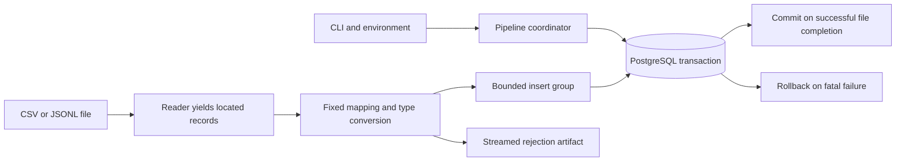
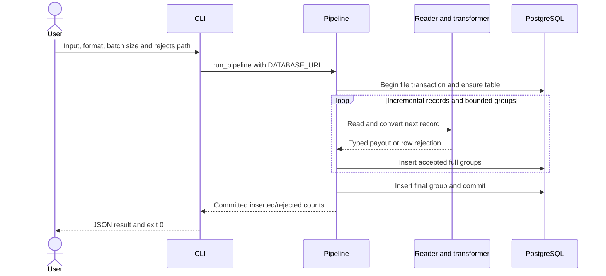
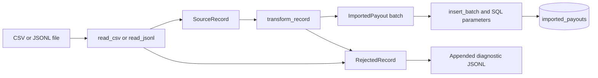
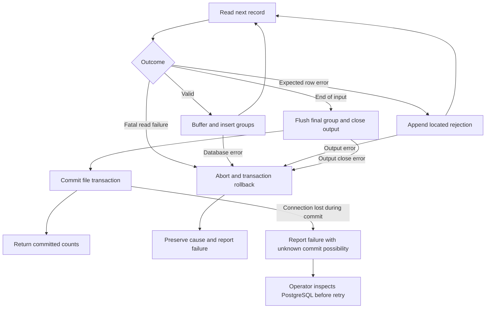

# Phase 1 — PostgreSQL transformation delivery

| Field | Value |
| --- | --- |
| Issues | None; implementation requested directly in chat. Follow-on experiments are issues #3 and #4. |
| Closing pull request | [PR #2](https://github.com/hhhhhusky777/claims-data-lab/pull/2) |
| Implementation acceptance | Owner accepted the audited implementation and authorized final validation on 2026-11-23 |
| Evidence owner | PR #2 holds final review, exact-head validation, merge authority and target verification |

This archive retains the complete concluded whiteboard and complete implementation plan. Historical task-stop statements below describe their recorded stage boundaries.

# Solution Whiteboard — Claims Data Lab

<!-- sdd: archived-whiteboard -->

| Field | Value |
| --- | --- |
| State | `CONCLUDED` |
| Need / issue | Phase 1 input-format transformation implementation |
| Owner | Repository owner hhhhhusky777 |
| Concluded design revision | `7b6d7cc23e545fce9e6599e4eae00aa5070d6a6e` |
| Open owner decisions | `None` |

## Discussion and reconciliation

| ID | Owner direction / earlier option | Resolution |
| --- | --- | --- |
| DR1 | Owner now requests complete implementation to read and learn, stopping after each completed task | D1 amended under A1 |
| DR2 | First correctness, then performance, then remaining knowledge areas | D2 retained |
| DR3 | Earlier SQLite reporting, update versions and duplicate detection | D3 supersedes with PostgreSQL transformation only, as explicitly requested |
| DR4 | Large inputs and bounded memory | D4 incremental reading and bounded insert groups |
| DR5 | PySpark queries and processing | Deferred until distributed processing work |

## Proposed concluded design

| ID | Outcome and boundary | Acceptance evidence |
| --- | --- | --- |
| D1 | Deliver fully implemented Python modules with type annotations, English docstrings, focused tests and runnable PostgreSQL transformation. Owner reads code to learn. Stop after every completed task for owner continuation. | Task-focused checks verify implemented outcomes; final acceptance includes actual PostgreSQL integration |
| D2 | Phase 1 runtime goal is CSV/JSONL to PostgreSQL, verified using SQL. Performance and extra features follow a correct baseline. | Integration tests query actual inserted columns and counts when implementation exists |
| D3 | Python 3.11+ with Psycopg 3. One input file per invocation. Plain inserts preserve every accepted record, including repeat IDs and versions. Each rerun imports the file again. No business-key merge, ordering, deduplication, policy reference check, financial aggregation or HTTP service. | Two rows with the same payout_id remain two rows |
| D4 | Sequential reader, transformer and writer in one process. Read one CSV logical record or JSONL line at a time, buffering at most configurable batch_rows transformed records. Document memory as O(largest record + bounded batch), not a hard byte ceiling. No producer queue or disk spool. | Reader iteration and batch-boundary tests, including final partial batch |
| D5 | Writer owns one PostgreSQL transaction per input file. Insert groups use executemany with bound parameters. Successful completion commits all accepted rows; fatal read or database failure rolls back the file. Preserve original exception causes. | Inject failure after an earlier insert group and verify no new rows survived |
| D6 | Expected conversion/validation failures produce a streamed JSONL rejection artifact with source path, record number and reason. They do not abort other valid records. Fatal errors close the artifact and mark the command failed. Rejection artifact is diagnostic, not an atomic database output. | Malformed JSON, missing field and invalid date are rejected with locations |
| D7 | CLI supplies input path, csv/jsonl format, batch_rows and reject path. Credentials come from DATABASE_URL environment variable. Validate positive batch_rows. No committed credentials; use synthetic fixtures and local development PostgreSQL only. | Invalid options fail before inserts; CLI reports outcome and committed inserted/rejected counts |

### Target schema and mapping

Use one fixed table `imported_payouts` for the first exercise. Map fields by name. A small fixed mapping has one conversion per column; no generic configuration engine.

| Column | PostgreSQL type | Input / conversion |
| --- | --- | --- |
| id | BIGINT GENERATED ALWAYS AS IDENTITY PRIMARY KEY | Database-generated technical ID |
| source_file | TEXT NOT NULL | Source path |
| source_record | BIGINT NOT NULL | 1-based CSV logical data record or JSONL physical line |
| payout_id | TEXT NOT NULL | Required nonempty input string |
| version | BIGINT NOT NULL | Required integer input, opaque payload; never used to order or merge |
| policy_id | TEXT NOT NULL | Required nonempty input string; no relationship validation |
| settled_on | DATE NOT NULL | Input YYYY-MM-DD string converted to date |
| currency | TEXT NOT NULL | Required nonempty input string; no external currency registry check |
| amount_cents | BIGINT NOT NULL | Signed integer cents from input |

CSV opens with utf-8-sig and newline=''. JSONL opens with utf-8-sig. Ignore extra fields. Require named columns in CSV header, allowing any order. CSV integer values use signed decimal integer text. JSON integer values must be actual integers, excluding booleans; both must fit PostgreSQL BIGINT. Missing/null required values are row errors. JSONL non-object values and blank lines are row errors. A malformed CSV stream or missing required CSV header aborts the file, because reliable record boundaries or mappings are unavailable. Existing JSONL samples are raw examples; add a payout CSV counterpart with known transformed values during fixture work. `policies.csv` is retained reference data and is outside this import's target contract.

### Architecture and behavior

Reader owns file decoding and record locations. Transform owns column conversion and required-field checks. Database writer owns inserts and transaction lifetime. Pipeline owns coordination and result counts. CLI owns argument handling and redacted failure display. Models hold typed input locations, rejected rows, transformed rows and run results. Use functions and data containers; no repository base classes or plugin framework. The database connection and files are explicitly closed.

## Research and alternatives

Psycopg transaction contexts support the selected commit/rollback boundary. executemany accepts multiple parameter sets; COPY is a later measured optimization. Sources read 2026-11-19: https://www.psycopg.org/psycopg3/docs/basic/transactions.html and https://www.psycopg.org/psycopg3/docs/api/cursors.html . PostgreSQL is owner-selected. Streaming instead of loading the file bounds memory independently of file length, subject to largest-record size. A queue adds coordination without a current throughput requirement. Per-group commits were rejected for this baseline because they leave partial files after failure. Very large file transactions may be expensive; revisit that boundary during measured performance work.

## KB coverage

| KB topic | Concrete application | State |
| --- | --- | --- |
| Architecture, scope and assumptions | D3 consumes records as supplied; opaque version fields confer no upstream semantics | Covered |
| Contracts and compatibility | Fixed target schema and mapping above; obsolete README business semantics must be replaced | Covered |
| Efficiency and concurrency | Sequential D4 avoids queue coordination; independent design reviews run separately | Covered |
| Experience and learning | Existing project Experience has no lessons; consult it and preserve verified lessons when implementation supplies evidence | Covered |
| Performance design | D2/D4 establish a bounded baseline; no numeric throughput goal or optimization claim | Covered |
| Proportional review | Review schema, rejection and transaction risks against the owner's narrow transformation scope; avoid speculative merge or queue requirements | Covered |
| Security basics | D7 environment credentials and synthetic data; rejection artifacts remain local and ignored | Covered |
| Simple design and reuse | Standard csv/json and Psycopg, one table and fixed mapping; no framework | Covered |
| Solution research | Official Psycopg sources support transaction and grouped-insert choices | Covered |
| Testing and reproduction | Compare real database values; fatal insert failure after an earlier group tests rollback | Covered |
| Error handling design | D5/D6 separate expected rejected records from fatal rollback and retain causes | Covered |
| Observability and diagnosability | CLI outcome, record locations, rejected counts and stage-aware errors via Python logging; no credentials in logs | Covered |

## Canonical authority updates

| Design | Canonical owner | Required update |
| --- | --- | --- |
| D2-D7 | README Phase 1 | Replace SQLite/report/replay contract with agreed PostgreSQL transformation contract during implementation delivery; preserve later roadmap |
| D1 | AGENTS.md | Its explicit-request exception permits full implementation under the owner’s new request |
| D2-D7 | Adoption manifest authority links | Reconcile obsolete report and version references with README, retaining installed pin and adoption boundaries |

## Newly introduced validations

| ID | Validation / authority / execution boundary | Protected outcome / risk / marginal value | Concrete invalid case | Failure effect / recovery | Cost / risk reduction | Existing or cheaper mechanism / coverage / why insufficient | Fail-close / test reference | Owner disposition |
| --- | --- | --- | --- | --- | --- | --- | --- | --- |
| V1 | D3/D6 required-field and type checks at transformation; framing/header checks at reader | Produce the promised table format and useful rejects | amount_cents is 'abc'; required CSV header absent | Row error is rejected and processing continues; framing/header failure aborts and rolls back; operator fixes source and reruns | Standard parsing and small schema checks prevent unusable rows | PostgreSQL checks types but cannot supply source-record diagnostics before batched failure | D5/D6 integration rejection and rollback tests | Approved |
| V2 | D4/D7 positive batch_rows at CLI | Prevent an invalid buffer configuration | batch_rows=0 | Reject command before inserts; operator sets positive value | One argument check | Database cannot validate client buffer configuration | CLI validation test | Approved |

## Newly introduced fail-closed behaviors

| ID | Trigger | Response | Concrete example | Impact | Recovery / best next action | Owner disposition |
| --- | --- | --- | --- | --- | --- | --- |
| FC1 | Fatal read, missing header, reject-output failure or database exception during a file | Abort and roll back its inserts; preserve error cause and report failure | Connection fails after the first insert group | This file has no committed inserts if rollback is confirmed; a connection loss during COMMIT may leave outcome unknown | Operator fixes dependency/input and checks PostgreSQL before repeating an ambiguous COMMIT; a confirmed rollback may be rerun | Approved |

## Material assumptions

| Assumption | Category | Evidence / handling | Impact if false |
| --- | --- | --- | --- |
| None | None | Supported input and operational boundaries are explicitly defined above | None |

## Design amendment A1

| Amendment | Changed design points | Reason and impact | Owner decision |
| --- | --- | --- | --- |
| A1 | D1 and corresponding learner-only descriptions | Owner requested all code implemented for reading and learning, with a stop after each task. D2–D7, target schema, V1/V2 and FC1 are preserved. | Owner accepted exact reviewed amendment and task plan in chat on 2026-11-19 |

## Human brief

A1 changes delivery from annotated stubs to complete implementation with focused tests. Proposed task boundaries are file parsing/transformation, PostgreSQL pipeline, then CLI and end-to-end documentation. Stop after each completed task. Previously accepted runtime contracts and rejection/failure dispositions are unchanged. No implementation is claimed yet.

---

# Implementation Plan — Phase 1 transformation implementation

<!-- sdd: archived-implementation-plan -->

## Delivery status

| Field | Value |
| --- | --- |
| State | `COMPLETE` |
| Active tasks | `None` |
| Next ready task | None; implementation complete |
| Active blocker | None |
| Implementation mode | human-review-before-merge; Autopilot off; stop after every completed task |
| Delivery branch / target | `feature/phase1-transform` / `main` |
| Owner | Repository owner hhhhhusky777 |
| Primary need | [PR #2](https://github.com/hhhhhusky777/claims-data-lab/pull/2) |
| Concluded whiteboard | [Solution](#solution-whiteboard--claims-data-lab), accepted A1 content `7b6d7cc`, frozen by `8f94dbe` |
| Required reviewers | Retained phase1_design_a and phase1_design_b |
| Last verified | 2026-11-19; owner accepted A1 and plan; both reviewers verified metadata-only conclusion transition |

## Governing inputs

The owner's narrowed transformation-only scope and explicit design acceptance govern delivery. The [whiteboard](#solution-whiteboard--claims-data-lab) owns D1–D7, V1/V2 and FC1. [AGENTS.md](../../../AGENTS.md) owns the learner-implementation boundary. Preserve fixture bytes and secrets. The owner explicitly requested fully implemented code for reading and learning. The assistant implements runtime code and focused tests with type annotations and English docstrings, then stops after each completed task. Performance tuning stays deferred. A1 supersedes the earlier stub-only boundary.

## Tasks and design mapping

All tasks use `feature/phase1-transform`, PR #2, required target `main`, under one final-PR integration model. There are no intermediate task merges. Only the final reviewed delivery may merge with separate owner authority. Assumptions consumed by each task: None.

| ID | State | Depends on | Consumed design | Implementation work and outcome | Boundaries | Error handling / validations | Acceptance evidence |
| --- | --- | --- | --- | --- | --- | --- | --- |
| T1 | DONE | None | D1, D3, D4, D6 | Implement models, errors, incremental CSV/JSONL readers and fixed transformation with focused unit tests | File-to-typed-record slice; database and CLI follow later | V1 row errors versus fatal framing/header errors; preserve source locations | Actual fixture records convert to expected types; rejects, extra/reordered columns, BOM, strict dates/integers and iterator behavior tested |
| T2 | DONE | T1 | D1–D7 | Implement database schema, writer-owned transaction, batched inserts and pipeline; test actual PostgreSQL behavior | Plain append, one file transaction, bounded batches; no business merge or queue | V1/V2 as consumed, FC1 rollback and unknown commit; diagnostic output failures propagate | Real PostgreSQL inserts, final partial batch, append-on-rerun and rollback-after-earlier-group evidence |
| T3 | DONE | T1, T2 | D1, D2, D7; canonical updates | Implement CLI, add corresponding CSV fixture, setup/run instructions, reconcile README/manifest and complete end-to-end tests | Environment credentials; scope remains transformation only | CLI V2, redacted stage errors, committed counts | CLI-to-PostgreSQL execution for both formats; actual rows and rejects verified; closing docs reviewed |

After each task passes its focused checks and both retained reviewers approve its exact candidate, mark it DONE and stop. The owner chooses when to continue. Do not start a dependent task automatically.

## Module and callable inventory

Each module has a purpose docstring. Each function/method has Inputs, Returns, Effects, Raises and an example where useful, and a complete implementation. Data containers use dataclasses with annotated fields where suitable. Use Python 3.11+ annotations, Psycopg 3 connection typing, pathlib.Path, datetime.date and collections.abc interfaces. Annotations describe supported values; they do not validate them at runtime.

| Module | Declaration | Implementation responsibility |
| --- | --- | --- |
| `models.py` | `SourceRecord(source_file: str, source_record: int, values: dict[str, object], input_format: Literal['csv', 'jsonl'] = 'jsonl')` | Parsed raw object with source location and format; format distinguishes CSV integer text from native JSON integers |
| `models.py` | `ImportedPayout(source_file: str, source_record: int, payout_id: str, version: int, policy_id: str, settled_on: date, currency: str, amount_cents: int)` | Fixed target fields; database generates technical ID |
| `models.py` | `RejectedRecord(source_file: str, source_record: int, reason: str)` | Row rejection diagnostic |
| `models.py` | `PipelineResult(inserted: int, rejected: int)` | Counts for a successfully committed file; failures raise instead of returning success |
| `readers.py` | `read_csv(path: Path) -> Iterator[SourceRecord \| RejectedRecord]` | Incremental logical CSV rows, required headers and UTF-8 BOM handling; fatal framing errors propagate |
| `readers.py` | `read_jsonl(path: Path) -> Iterator[SourceRecord \| RejectedRecord]` | Incremental physical lines; malformed JSON and non-object values produce located rejects |
| `transform.py` | `transform_record(record: SourceRecord) -> ImportedPayout` | Fixed field mapping, required fields and strict integer/date conversion; raise RowValidationError for expected row errors |
| `errors.py` | `RowValidationError(ValueError)` | Type declaration for expected transformation errors; no custom methods |
| `database.py` | `transaction(connection: Connection) -> AbstractContextManager[None]` | Writer-owned context manager commits on success and rolls back fatal failure; pipeline enters it without duplicating transaction logic |
| `database.py` | `create_tables(connection: Connection) -> None` | Create the agreed fixed schema inside the writer-owned transaction |
| `database.py` | `insert_batch(connection: Connection, records: Sequence[ImportedPayout]) -> int` | Bind values and use executemany; plain inserts, return staged count, never commit here |
| `pipeline.py` | `run_pipeline(input_path: Path, input_format: Literal['csv', 'jsonl'], database_url: str, reject_path: Path, batch_rows: int) -> PipelineResult` | Own file/connection cleanup and coordinate processing inside database.transaction; flush partial final group and stream rejects; propagate fatal errors through writer rollback while preserving causes |
| `cli.py` | `main(argv: Sequence[str] \| None = None) -> int` | Parse arguments, read DATABASE_URL, validate batch_rows before inserts, invoke pipeline, redact secrets and display outcome |

The fixed field conversion in transform.py is the mapping. Avoid generic schema/mapping frameworks, queue classes, report/API modules and repository abstractions. Table creation is called inside the pipeline's setup/transaction boundary. Each successful invocation appends rows. Logging uses Python's logging framework with source/stage context, excluding database credentials.

## Acceptance inventory

| Owner | Scenario | Current coverage / boundary |
| --- | --- | --- |
| T1 | Real fixture JSONL conversion; equivalent CSV records; malformed/non-object/blank JSONL; missing/null fields; strict dates and BIGINT integers including booleans and overflow | Implemented in tests/test_transformation.py; 18 tests passed on Python 3.14.5 |
| T1 | Reordered/extra CSV columns, required headers, malformed framing, logical CSV record numbers, BOM and incremental iteration | Implemented in tests/test_transformation.py; 18 tests passed on Python 3.14.5 |
| T2 | Actual PostgreSQL schema and inserted values; repeated IDs/reimport append; opaque version values | Implemented in tests/test_pipeline.py; real PostgreSQL 16.14 integration passed |
| T2 | Bounded insert groups and final partial group; confirmed rollback after earlier insert; unknown commit truthfully propagated | Implemented in tests/test_pipeline.py; 14 T2 tests passed, including simulated unknown-COMMIT propagation |
| T2 | Rejection output remains diagnostic; output/read failure aborts file transaction | Implemented in tests/test_pipeline.py; real PostgreSQL 16.14 integration passed |
| T3 | CLI options, DATABASE_URL handling, invalid batch_rows before inserts, redacted errors, committed counts | Implemented in tests/test_cli.py; 10 focused T3 tests passed |
| T3 | Both real input formats through CLI into PostgreSQL, expected values and reject locations | Implemented subprocess-to-PostgreSQL cases in tests/test_cli.py; focused T3 checks passed |

## Validation, review and completion

Run task-focused tests before both retained reviewers inspect each completed task. Use an isolated local development PostgreSQL instance for database checks, verifying environment ownership first. Reuse available dependency caches and follow host download rules before fetching packages or images. If actual PostgreSQL evidence cannot be obtained, report the gap and leave T2 incomplete rather than substitute mocks for integration proof. Unit tests may isolate failure paths that cannot be safely reproduced with a real connection. Final-gate checks wait for the playbook implementation audit and human acceptance.

Before final tests, complete the playbook implementation audit, retained reviews and human implementation acceptance. Before final merge review, reconcile README and manifest, preserve the full concluded whiteboard and plan in one closing archive, reset the live whiteboard and remove this live plan according to the accepted closing workflow. Detailed approval, validation and merge evidence belongs in PR #2. No archive/reset occurs during planning.

| Delivery outcome | Definition of Done | Current result |
| --- | --- | --- |
| File transformation | Complete typed readers and conversion with focused tests | Implemented; 18 focused tests passed; both retained reviewers approved T1 candidate 42e52d6 |
| Transactional ingestion | PostgreSQL file transaction and bounded inserts verified | Implemented; 14 focused T2 tests passed against PostgreSQL; both reviewers approved 15bcc4a |
| Runnable learning project | CLI, fixtures and README/manifest reflect tested PostgreSQL behavior | Implemented; 10 focused T3 tests passed; both retained reviewers approved 524935a |
| Merge candidate | Required review, exact-head validation and closing archive/reset | Combined archive and neutral live workspace prepared; final review/check/merge evidence is owned by PR #2 |

## Task T1 result

Implemented claims_data_lab models, errors, readers and transformation with the Python standard library. SourceRecord includes input_format metadata to distinguish CSV numeric strings from strict JSON native integers. Both retained reviewers approved exact T1 candidate 42e52d6 with no findings and independently passed all 18 tests. Task T1 is DONE; execution stops until owner continuation. No database, queue or CLI behavior is introduced. Python 3.14.5 focused test command `PYTHONDONTWRITEBYTECODE=1 python3 -m unittest discover -s tests -v` passed 18 tests. The tests use actual temporary files and tracked JSONL fixtures. PostgreSQL and end-to-end obligations remain owned by T2/T3.

## Task T2 result

Implemented database.py (fixed table schema, writer-owned transaction, parameterized executemany groups) and pipeline.py (incremental orchestration, rejection JSONL and committed counts). Dependencies are pinned in requirements.txt. run_pipeline takes an explicit batch_rows with no default; diagnostics append to existing rejection files so confirmed-rollback retries can reuse the same paths. The rejection path must be distinct from the input, including aliases, to preserve source bytes under the existing project content-protection boundary.

Fourteen T2 focused tests passed against a dedicated PostgreSQL 16-alpine container with private per-test schemas. Test entry point: `TEST_DATABASE_URL=<isolated-test-url> PYTHONDONTWRITEBYTECODE=1 .venv/bin/python -m unittest discover -s tests -p test_pipeline.py -v`. Reuse the pinned requirements in a virtual environment. Integration tests are explicitly skipped when TEST_DATABASE_URL is absent. Confirm that the supplied database is a disposable local test instance before using it. Real database evidence covers typed CSV/JSONL inserts, bounded/final groups, append-on-repeat, rejection locations, confirmed rollback after framing/database/output failures and append-to-existing diagnostic output and input/alias preservation. Unknown-COMMIT identity and retry behavior are tested with an isolated simulated driver failure; no real network fault is claimed.

Both retained reviewers approved corrected T2 candidate 15bcc4a with no unresolved findings. Task T2 is DONE; execution stops before T3. The verification container is owned by this task with labels codex.project=claims-data-lab and codex.task=T2; it reuses the cached postgres:16-alpine image. Unrelated environments are outside its scope. After review, the owned test container and its anonymous data volume are removed; the virtual environment is retained for reuse. Product README and manifest contract reconciliation are delivered by T3, replacing the superseded reporting instructions.

## Human decision

A1 and the revised plan were accepted in chat. Stop after T1 completes its focused checks and retained reviews. T2 continuation was explicitly authorized in chat. T3 continuation was explicitly authorized in chat. Stop after its focused checks and retained reviews; final feature readiness and merge remain separate. Autopilot is off; final audit/validation and protected-target merge remain separate decisions.

### T2 review correction

Reviewer A found that exclusive diagnostic output creation introduced an unnecessary existing-path prohibition. Removed that prohibition: diagnostics append across runs. Tests now reuse the same paths and verify preserved earlier diagnostic rows. A direct/symlink/hardlink input-output collision is prevented to preserve the source, consuming the existing AGENTS.md protected-content obligation. No automatic replay, business-key handling or new pipeline stage was added.

## Task T3 result

Implemented cli.py and __main__.py, the equivalent CSV payout fixture, local setup/inspection/cleanup instructions and the PostgreSQL transformation contract in README. Reconciled stable manifest authority links and gaps. CLI requires explicit positive batch_rows and format; DATABASE_URL comes from the environment. It returns committed counts as JSON with exit 0, fatal pipeline failures with exit 1 and argument/environment errors with exit 2. Raw exception/connection strings are withheld from CLI output while the Python API retains the original errors.

Focused command: `TEST_DATABASE_URL=<isolated-test-url> PYTHONDONTWRITEBYTECODE=1 .venv/bin/python -m unittest discover -s tests -p test_cli.py -v`. Both retained reviewers approved exact task candidate 524935a with no findings and independently reran all ten focused tests. Task T3 is DONE; stop before final feature readiness. Ten T3 tests passed on Python 3.14.5 with Psycopg 3.3.2 against a task-owned PostgreSQL 16-alpine container, including four subprocess-to-database cases. Unit cases verify parser behavior, missing credentials, committed-count output and redaction. Subprocess cases verify both actual fixture formats, rejects, fatal rollback and argument rejection before database effects. Relative links and whitespace checks passed. Final feature validation has not run; the owner’s requested task stop precedes final readiness and archive/reset.

The task-owned T3 verification container and anonymous data volume are removed after review. Dependencies remain in the existing virtual environment for reuse. No final audit, full-suite result, archive/reset or merge readiness is claimed at this task stop.

## Implementation review

| Information | Implementation summary / evidence |
| --- | --- |
| Implementation / design | D1–D7 implemented across models/readers/transform, database/pipeline and CLI. Fixed mapping, opaque version payload and plain append preserved. Writer owns one file transaction with parameterized executemany groups. T1/T2/T3 task reviews approved the exact task candidates recorded above. |
| Code-level flows | Business sequence, data flow and error activity below describe current cli.py, pipeline.py, readers.py, transform.py and database.py. |
| Review findings | Task review found the unnecessary exclusive rejection-output rule; it was removed in 15bcc4a and both reviewers approved append behavior plus source protection. Final combined audit findings belong in PR #2. |
| Risks / limits / unknowns | Largest-record size is unbounded; batch_rows limits record count. File transactions may be large. No schema migrations, deduplication, update semantics, parallel pipeline, Spark or performance target. Unknown COMMIT uses a driver simulation in tests, not a real network fault. Rejection artifacts can survive rollback. |
| Validation | Task-focused results: 18 T1, 14 T2 and 10 T3 cases passed at their recorded candidates. Owner accepted the audited implementation on 2026-11-23. The complete 42-test suite passed against actual PostgreSQL at audit candidate 59bd190, with no skips. Exact closing-head review and checks are recorded in PR #2. Product/test content is unchanged. |
| Recommendation / decision | Owner accepted the combined implementation and authorized final validation. The closing candidate preserves the full design/plan archive and resets the live workspace. Protected-target merge remains a separate owner decision recorded in PR #2. |

### Business sequence

### Data flow

### Error activity

## Phase 2 handoff

The owner selected a starting benchmark profile on 2026-11-23: 100,000 and 1,000,000 synthetic rows, 500-row groups, three runs per size, one importer and one isolated local PostgreSQL instance, measuring throughput and peak memory before setting improvement targets. [Issue #3](https://github.com/hhhhhusky777/claims-data-lab/issues/3) records this agreement. Phase 2 starts with a reproducible sequential baseline; data-shape/resource details and a normal Phase 2 design remain to be recorded. No Phase 2 product code or benchmark run has begun. This handoff does not alter the frozen Phase 1 design.

## Final validation and cleanup

The owner explicitly accepted the Phase 1 implementation and final test suite in chat on 2026-11-23. All 42 tests passed with TEST_DATABASE_URL set to the task-owned PostgreSQL instance; there were no skips. The first combined run binds to 59bd190. Exact closing-candidate reviews, final test result and merge evidence are retained in [PR #2](https://github.com/hhhhhusky777/claims-data-lab/pull/2). No product or test edits were required after the accepted implementation audit. Unknown-COMMIT coverage remains a driver simulation.

| Design / task | Delivered outcome | Remaining obligation |
| --- | --- | --- |
| D1 / T1 | Typed models, real-file incremental readers and fixed conversion | None |
| D2–D6 / T2 | Parameterized PostgreSQL groups, file transaction and reject diagnostics | None |
| D7 / T3 | CLI, fixture parity, documented setup and subprocess integration | None |
| Closing delivery | Complete whiteboard/plan preserved below; live whiteboard EMPTY and live plan removed | Final review, exact-head checks and owner merge authority in PR #2 |

| Cleanup item | Disposition | Boundary |
| --- | --- | --- |
| Phase 1 whiteboard and plan | Preserve complete contents in this combined archive | Marker replacement and archive-relative link correction only for source preservation |
| Live solution-whiteboard.md | Reset to neutral EMPTY state | No next feature inferred |
| Live implementation-plan.md | Remove after archive exists | No active delivery remains |
| Product code, tests, fixtures, README, manifest, Experience and managed KB | Keep | Reusable project output and authority |
| Owned final-verification PostgreSQL container and anonymous volume | Remove after final checks | Labels codex.project=claims-data-lab and codex.task=final-validation; preserve unrelated stacks |
| Owned worktree/branch | Retire only after authorized merge and target verification | Preserve checkout and virtual environment until then |
