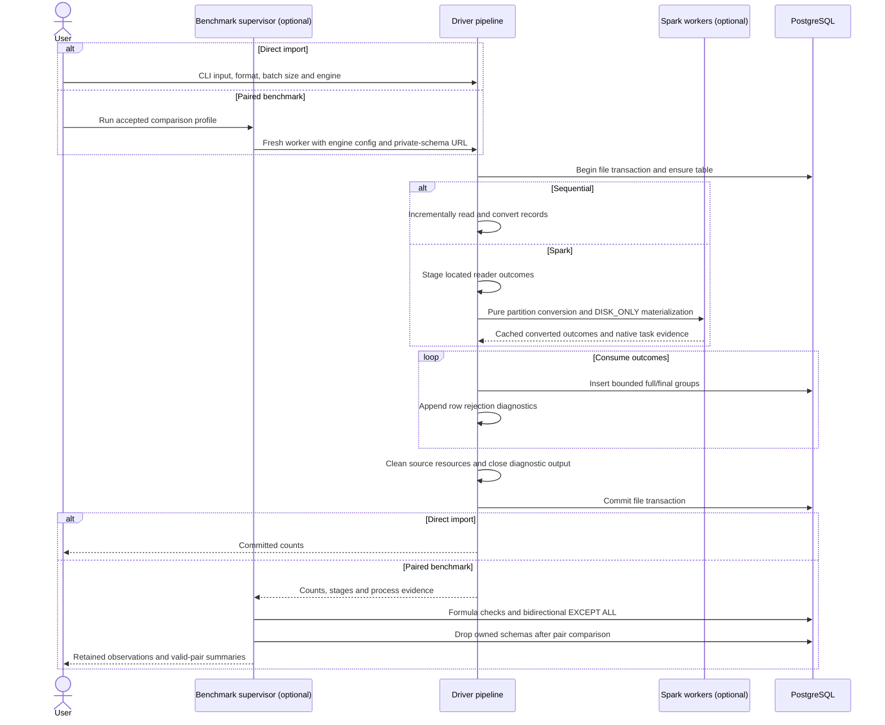
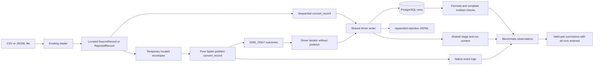
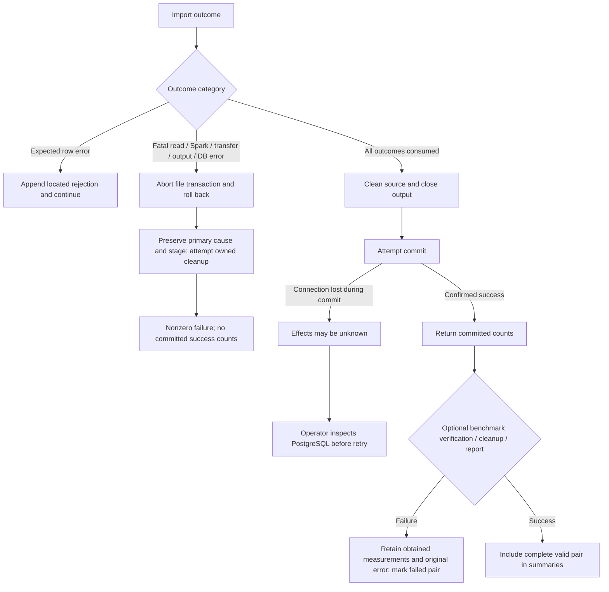

# Implementation Plan — Phase 2 Spark transformation

<!-- sdd: implementation-plan -->

This is the only active-delivery state authority. Review comments, exact run results and approvals belong in [PR #5](https://github.com/hhhhhusky777/claims-data-lab/pull/5).

## Delivery status

| Field | Value |
| --- | --- |
| State | `IN_PROGRESS` |
| Active tasks | Combined implementation audit; T1–T3 complete |
| Next ready task | Final validation after audit approvals and explicit owner implementation acceptance |
| Active blocker | Owner implementation acceptance required before final-test work, after retained audit approvals |
| Implementation mode | Human-controlled, human-review-before-merge; Autopilot OFF |
| Authorized scope / feature branch / protected target | Accepted design D1–D6; feature/phase2-spark; main. Design acceptance is not plan acceptance or merge authority |
| Delivery branch / target | feature/phase2-spark → main, one feature PR #5 |
| Owner | Repository owner hhhhhusky777 |
| Primary issue / need | [Issue #4](https://github.com/hhhhhusky777/claims-data-lab/issues/4) |
| Concluded whiteboard | [Whiteboard](solution-whiteboard.md), accepted design 223fbcf; metadata conclusion 144013f verified by both retained reviewers |
| Required reviewers | phase2_review_a and phase2_review_b, retained independently through merge |
| Last verified | 2026-11-24; design accepted/frozen; Owner approved continuation after T3; combined implementation self-audit prepared against6273343; PR owns audit dispositions; no final tests run; Autopilot OFF |

## Governing inputs and delivery boundaries

Source hierarchy: explicit owner decisions and [AGENTS](../../AGENTS.md); the accepted [whiteboard](solution-whiteboard.md), [README](../../README.md) contracts and [manifest](project-adoption-manifest.md); implementation/test evidence at its exact candidate. Installed playbook revision d038cdb is current. All Architecture and Engineering KB topics were read before planning; apply them within these contracts.

The outcome is an optional, correctness-preserving local Spark transformation path plus reproducible evidence against the sequential importer. Speedup is not required. Scope is D1–D6; distributed databases, parallel JDBC/Psycopg writers, COPY, pipeline overlap, cloud and AI are excluded. English readable implementation is authorized by the owner's continuing full-code learning request; stop after each reviewed task for reading and explicit continuation. Do not replace these stops with automatic task advancement.

No unsupported material assumption is used: accepted workload/resource conditions are explicit in D5, while actual runtime viability, partition overlap, memory and performance remain measurements to obtain. Current verified Python is 3.12.9, host capacity 16 GiB RAM/10 logical CPUs, and Java/PySpark are absent. Runtime setup is task work, not a prerequisite requiring the task's future outputs to exist. Any required proxy allowance remains an independent host permission.

## Accepted design key points

| Design | Accepted contract to consume |
| --- | --- |
| D1 | Optional sequential/spark engine; existing calls and omitted option remain sequential without Spark dependencies |
| D2 | Existing real-file readers stage complete located SourceRecord/RejectedRecord envelopes, retaining CSV logical rows and native JSON values |
| D3 | Pure mapPartitions calls reuse transform_record; DISK_ONLY materialization precedes driver iteration; prove actual overlapping transformation tasks |
| D4 | One shared driver writer retains parameterized groups, file transaction, rejects and alias protection; workers have no external writes/credentials |
| D5 | Accepted deterministic profile, resources, complete-value correctness and honest stage/end-to-end/RSS comparisons; no speed target |
| D6 | Small readable task outcomes, reusable local runtime, task reading stops, human final implementation acceptance and merge authority |

## Tasks — design-to-task mapping

All tasks are reviewed commit increments in the same feature PR; they do not merge individually into main. The task table is the only design-to-task mapping.

| ID | State | Depends on | Consumed design | Implementation work | Outcome | Boundaries | Consumed error handling | Consumed validations | Acceptance evidence | Consumed assumptions | Branch / PR / required target |
| --- | --- | --- | --- | --- | --- | --- | --- | --- | --- | --- | --- |
| T1 | DONE | None | D5 workload/measurement; D6 readable task stop | Add deterministic CSV/JSONL generation and a runnable sequential benchmark supervisor; integrate shared logging/run/stage timing and psutil memory sampling with current import; document setup/benchmark commands and accepted workload in README; prepare worktree-local Python 3.12.9 dependencies and owned PostgreSQL from persistent caches/mirrors | A reader can generate the accepted datasets, run the unchanged sequential algorithm in fresh processes and inspect reproducible baseline results | Sequential only; do not tune batch size, replace inserts, add Spark execution or promise speed. Keep base Psycopg 3.3.2. Record/lock benchmark dependency versions after metadata verification. Generated files/results stay ignored | Phase 1 reader/DB/output exceptions preserve causes; failed subprocesses reported as failed runs, not throughput successes; only owned schemas/container/temp files cleaned; interrupted COMMIT requires inspection | Existing argparse/import validation and task-focused tests; no new admission gate. D5 independent formula/value evidence for generated files and truthful measurement units | Generator parity including duplicate IDs/negative amounts; supervisor success/failure and measurement interval tests; real PostgreSQL baseline for both formats × two sizes × three repeats, with bytes/hashes, per-run counts and complete expected values; focused checks on modified pipeline behavior; task review and reading stop | Accepted D5 profile; record actual Docker limits and host state. Setup/download route unresolved until preflight, not assumed DIRECT | feature/phase2-spark; PR #5; target main |
| T2 | DONE | T1 | D1–D4 Spark path; D5 shared evidence format; D6 stop | Preflight/install pinned Spark 4.0.4/Java 17 locally; add located-envelope adapter and pure partition conversion using current readers/converter; materialize DISK_ONLY outcomes and iterate without prefetch; extract common writer orchestration and add engine selector; update engine setup/ownership/memory docs | Both engines import supported real files through one writer with matching stored values/reject locations and file rollback | Local classic Spark only; minPartitions=8/local[2]; DB stays driver-only. Preserve default API/CLI, output, source bytes and diagnostic append behavior. No collect of the whole dataset, native parser replacement or executor-side writes | Consume accepted D2–D4 and Phase 1 fatal/row distinction, original causes/stages and COMMIT uncertainty. Source/cache/session cleanup must not hide originating errors; no silent engine fallback | Approved V1/FC1 via existing argparse choices; preserve all Phase 1 validations; missing runtime/worker/disk failures use existing fatal boundary | Real Spark+PostgreSQL parity on CSV/JSONL and multiline/type/reject fixtures; repeat append; fatal reader/worker/materialization failure before loading, plus rollback after an earlier group for later driver-iteration/output/DB failures; owned cleanup; no DB credentials captured by workers. Event logs prove distinct overlapping transformation tasks. Focused CLI tests prove default sequential and invalid-engine exit before import | Accepted D5 runtime/profile, verified exact Java build and Python/SDK pins in evidence; local file staging does not establish remote-cluster support | feature/phase2-spark; PR #5; target main |
| T3 | DONE | T2 | D5 comparative interpretation; D6 stopping and canonical closure | Extend the T1 supervisor to alternate both engines under identical accepted conditions; compare complete value multisets after each pair; collect all results, stage timing, process-tree RSS and native Spark task/partition evidence; reconcile README and manifest; document evidence-based limiting stage and later experiment candidates in PR | A reader can reproduce and explain the comparison, including a slower Spark result, without confusing local parallelism with cluster scaling | Both formats × two sizes × two engines × three measured runs, fresh processes/private schemas. Include startup/staging/materialization/transfer/commit/cleanup costs; nested SQL time is not added twice. No new optimization or numeric target | Failed runs retain diagnostics and remain failed evidence; do not silently rerun/cherry-pick. Preserve cleanup/COMMIT boundaries from D4 | D5 output parity and measurement evidence under existing delivery validation; no additional runtime gate | Real comparative runs with full nonsecret commands/configuration, commit, row/byte/hash context, every observation plus median/range, sampled RSS limitations, largest partition size and actual task overlap; independently reviewed interpretation and reading stop | D5 accepted controlled profile and disclosed OS/DB cache warmth; no assumption of faster Spark or representative production traffic | feature/phase2-spark; PR #5; target main |

### Why these dependencies exist

T2 consumes T1's repeatable datasets, common measurements and verified sequential behavior, so later writer extraction can be assessed against a known baseline. T3 consumes the working two-engine importer and measurement path from T2. Task execution remains sequential for the requested learning stops; the two independent reviewers may work concurrently. Each task must finish focused tests and both retained reviews before being reported DONE.

## Test and acceptance contracts

This inventory owns coverage, not test-run history. Concrete test names are finalized during the owning task without adding product requirements. The existing unittest harness remains the test framework.

| Owning task | Contract, changed outcome, or risk | Test or scenario | Coverage | Work boundary |
| --- | --- | --- | --- | --- |
| T1 | D5 deterministic formulas, equivalent formats, seed/byte evidence | Real generated files at small known row counts; independent expected rows, duplicate multiplicity and signed amounts; deterministic repeat hashes | Implemented in tests/test_benchmark.py | Focused T1 |
| T1 | D5 truthful supervisor intervals/counts/failures, sampled RSS units | Controlled subprocess success/failure; zero failed-run success claims; metadata excludes credentials; psutil sampling semantics and SQL nested interval interpretation | Implemented in tests/test_benchmark.py | Focused T1 |
| T1 | Existing reader/writer/CLI behavior after instrumentation | Existing relevant transformation/pipeline/CLI tests against owned PostgreSQL, limited to affected paths; observe unchanged values/exit semantics | Existing test_pipeline.py and test_cli.py; relevant checks passed | Focused T1 |
| T1 | D5 sequential baseline | Both real-file formats, 100k/1M rows, three observations each; fresh importer/private schema; complete expected-value checks outside measured interval | Complete at52dda28; exact results in PR #5 | T1 acceptance evidence |
| T2 | D1/V1/FC1 optional engine/default/argument rejection | Existing API/CLI plus engine-option cases, absent Spark for sequential, typo rejected before DB/import effects | Implemented in tests/test_spark_transform.py | Focused T2 |
| T2 | D2/D3 exact parser/conversion/location parity | Real Spark + fixtures: BOM, multiline CSV, malformed JSONL, empty input, extra fields, integer type/range, dates, repeated IDs; compare complete payout/reject multisets | Implemented real-file Spark/PostgreSQL parity | Focused T2 |
| T2 | D3 pure task execution/serialization and real concurrency | Real task event evidence with local[2], multiple nonempty partitions and overlapping conversion task intervals; no worker DB/output effects | Implemented native-event overlap witness | Focused T2 |
| T2 | D4 one-file transaction and source/output safety | Reader/worker/materialization failure before loading aborts; after an earlier batch, a later driver-iteration/output/DB failure rolls back. Do not invent a worker-after-write execution order: ordinary conversion materializes first. Aliases preserve source; diagnostics append; owned temp/cache/session cleanup; uncertain COMMIT remains simulated and disclosed | Implemented existing/common-writer and real Spark failure scenarios | Focused T2 |
| T3 | D5 comparable results and duplicate/source parity | Full stored multiset comparison after each engine pair; all observations preserved, independent known-row checks, failed data not labeled successful | Implemented in tests/test_comparison.py and retained full benchmark evidence | Focused T3 and benchmark evidence |
| T3 | D5 latency/throughput/resource interpretation | Whole subprocess interval includes startup/cleanup; stage boundaries and nested SQL consistent; driver/JVM/Python RSS samples and separate DB memory, partition sizes and overlap tied to each run | Implemented in tests/test_comparison.py and retained full benchmark evidence | Focused T3 and benchmark evidence |
| Final delivery | All accepted changed outcomes and material risks | Reconcile this inventory after all tasks, add any necessary missing cases only after required implementation audit and owner acceptance; full project suite with real PostgreSQL/Spark at final reviewed head | Unrun | Final gate after human implementation acceptance |

Commands will be documented in README as runnable entry points when each task implements them. Do not invent passing command evidence at plan time. Existing full-suite command is `TEST_DATABASE_URL=<owned-test-url> .venv/bin/python -m unittest discover -s tests -v`; Spark cases must actually run in final validation, not be counted as passed skips. Runtime validation is `./install-sdd.sh --validate`. Exact command/environment/results belong to PR #5.

## Integration, compatibility and readiness

| Concern | This delivery |
| --- | --- |
| Integration model | Single feature PR #5, feature/phase2-spark → main; no task PRs or intermediate task merges |
| Compatibility | Omitted engine and existing run_pipeline calls retain sequential behavior; no Spark requirement on that path. SQL schema/append semantics and source locations stay unchanged |
| Migration | No data migration. README documents optional Spark setup; separate pinned benchmark/Spark requirements can keep base dependencies small |
| Recovery | Use default sequential engine for subsequent confirmed-safe imports if Spark setup is unavailable; never automatically retry/fallback after an ambiguous failed import |
| T1 starting inputs | Frozen design, runnable Python 3.12.9 and isolated worktree are present. Dependency installation/cache reuse, owned database startup and benchmark artifacts are T1 work |
| Runtime/download ownership | Worktree-local environment or project-owned immutable reusable support; never depend on another active checkout's mutable runtime. Preflight all indirect package/image downloads, domestic direct routes and caches under host policy; preserve unrelated stacks and keep 6060 closed |
| Resource isolation | One owned disposable PostgreSQL container and per-run schemas; no concurrent benchmark jobs; source files immutable during a run; create/remove only invocation-owned temp/cache outputs |
| Merge authority | Owner accepts implementation before final tests and explicitly authorizes main merge later; neither design/plan acceptance nor reviewer approval grants merge authority |
| Autopilot choice | OFF recommended to preserve code-reading stops. Enabling it would require explicit owner change to automatic in-scope task advancement. This single-PR route has no intermediate task merges; final implementation acceptance and main merge remain human decisions |

## Risks, gaps and recovery

| Risk / gap | Handling | State |
| --- | --- | --- |
| Java/PySpark absent; exact package/build and route not yet verified | T1 provisions only its benchmark dependencies; T2 resolves/pins compatible Spark/Java and tests real tasks. Use persistent caches/direct mirrors where verified; request proxy allowance only if the global policy requires it | Expected setup work, not a product-design gap |
| Small conversion may not benefit from Spark | Include serial staging/materialization/transfer and startup; preserve sequential default; slower result satisfies learning/evidence outcome | Accepted D5 boundary |
| Largest-record/partition memory and disk staging | Measure actual sizes/RSS under accepted profile; do not claim configured heap or iterator is a hard total-memory cap | Accepted D2/D5 boundary |
| Large file transaction and ambiguous COMMIT | Reuse one-file ownership and existing operator inspection before retry; no distributed writer or automatic replay | Accepted D4 boundary |
| An implementation reveals a contract/scope mismatch | Pause affected work and use the existing design-amendment authority; routine equivalent engineering choices remain discretionary | No mismatch identified |

## Plan validation and completion

### Implementation review

The owner approved continuation after T3 on 2026-11-24. Author self-review approves the complete implementation carried by6273343: it follows accepted D1–D6, consumes existing parsing/conversion/transaction contracts and reuses standard libraries plus Psycopg, PySpark and psutil. This audit preparation changes documentation only. No product/test edits, missing-test additions or final-suite execution occur at this gate. Exact retained-review dispositions belong in [PR #5](https://github.com/hhhhhusky777/claims-data-lab/pull/5).

| Information | Implementation summary / evidence |
| --- | --- |
| Implementation / design | D1–D4: optional Spark engine with sequential default, located staging, pure partition conversion and one shared driver-owned PostgreSQL file transaction. D5–D6: deterministic real workloads, fresh-process paired measurements, complete multiset verification and preserved task reading stops. README/manifest carry the implemented contracts; overlap remains issue#6 |
| Code-level flows | Business sequence, data flow and error activity below match current pipeline.py, spark_transform.py, benchmark_worker.py, benchmark.py and comparison.py; source links follow the views |
| Review findings | Historical reporting loss fixed in52dda28 and completed for final observation writes infa02dba. Extra API rejection removed in2dfb43d, preserving CLI V1/FC1. No outstanding author finding; both retained audit dispositions are owned by PR #5 |
| Risks / limits / unknowns | Local[2] only; serial parsing/staging and full materialization before loading. Largest record/partition and JVM/Python overhead have no hard total-memory bound. File transactions can be large; imports append on repeat. SDK socket warnings persist; sustained stability, cold-cache behavior and production/multi-node capacity are unproven. Unknown-COMMIT coverage is driver simulation, not a real network-fault test |
| Validation | Reviewed task-specific checks remain tied to their recorded candidates, including T2's75focused passes at2dfb43d and T3's42focused passes atfa02dba (overlapping suites). Full24-import comparison passed complete checks for13.2Mrows atcleanfa02dba. Audit introduces no test run. Final combined suite remains unrun; required coverage inventory is retained above |
| Recommendation / decision | Author recommends accepting the combined implementation and running final validation after both retained audit approvals. Owner implementation acceptance is required before final-test work; protected-target merge remains a separate decision |

#### Business sequence

This view follows one import, called directly or from a fresh benchmark worker. A benchmark checks both committed private tables after the pair completes, outside importer timing.

#### Data flow

D1–D5 keep one owner for parsing, conversion and writes. Workers receive located input records and conversion code, not database URLs or write handles. SQL insert time nests inside driver consumption; benchmark verification is outside importer timing.

#### Error activity

Expected row errors continue. Fatal import failures roll back the file; diagnostic artifacts may remain. A benchmark failure after a successful child commit is a failed observation/pair, not a retroactive import rollback. Unknown COMMIT requires inspection rather than automatic retry.

Source reading anchors: [driver/writer](../../claims_data_lab/pipeline.py), [pure conversion](../../claims_data_lab/transform.py), [Spark adapter](../../claims_data_lab/spark_transform.py), [transaction](../../claims_data_lab/database.py), [measurements](../../claims_data_lab/measurements.py), [worker](../../claims_data_lab/benchmark_worker.py), [per-run benchmark](../../claims_data_lab/benchmark.py), [paired comparison](../../claims_data_lab/comparison.py).

### Delivery Definition of Done

| Outcome | Required evidence | Result / link |
| --- | --- | --- |
| Accepted D1–D6 delivered | Task mapping above, actual code and independent reviews | T1–T3 outcomes delivered; combined implementation audit remains |
| Applicable validation | Real files, real Spark/PostgreSQL, complete-value/rejection parity, rollback and default compatibility; final exact-head suite with integration enabled | Pending |
| Accepted performance evidence | Repeated baseline/comparison with all observations and disclosed resource/measurement limits; slower results reported honestly | Complete atfa02dba; full results and retained reviews in PR #5 |
| Live canonical updates | README engine/setup/transaction/memory/benchmark commands and performance authority; manifest inventory/gaps reflect implemented contract; AGENTS unchanged per accepted authority table | T1–T3 documentation reconciled; verify again at final readiness |
| Final implementation acceptance | Complete actual implementation brief and diagrams, exact author/two-reviewer audit, then owner acceptance | Pending, after T3 |
| Merge-ready canonical state | Complete whiteboard+plan archive before live plan removal and neutral whiteboard reset; final candidate reviews and exact-head validation | Pending |
| PR-owned delivery | Owner plan acceptance, task reviews, final acceptance/checks, separate main merge authority and target verification | PR #5 owns live evidence |

### Cleanup inventory

| Item | Disposition | Ownership / boundary |
| --- | --- | --- |
| Whiteboard and this plan | Preserve complete sources in one combined Phase 2 archive at closure; then reset live whiteboard/remove live plan | Only after final implementation acceptance and required closure preparation; no reset at task stops |
| Product, tests, synthetic seed fixtures, README, manifest, Experience and managed KB | Keep | Reusable project output and authority |
| Generated workloads, benchmark reports and Spark event logs | Keep ignored locally while needed; retain sanitized evidence in PR | Exact created paths recorded by owning task; no deletion of unrelated artifacts |
| Owned PostgreSQL container/volume and private schemas | Remove at the end of each verification boundary when no longer needed | Record labels/name and schema ownership first; preserve unrelated data/stacks |
| Invocation-owned envelopes/cache/session | Clean on success/failure according to D2–D4 | Exact run temporary directory, Spark persistence/session ownership |
| Worktree/runtime/branch | Retire after authorized merge and exact-target verification; preserve reusable caches | This delivery only, following installed completion contract |

## Human review brief

DISCLOSE: T1–T3 are complete with task-focused checks and actual comparison evidence; current local Spark is slower and uses more sampled RSS under the accepted profile. HUMAN_DECISION: explicit implementation acceptance after the combined audit before final tests; protected-target merge remains separate. Autopilot stays OFF. NONE: new design decisions, rejection rules or unresolved findings. Detailed reviews and all run results belong in PR #5.

## T1 actual result and reading stop

T1 is implemented at `52dda280d9f90151e1a7794a10620889f87cd802`. The subsequent task-stop candidate changes documentation/state only; product/test hashes remain unchanged. All 43 focused tests passed (19 benchmark, 14 pipeline, 10 CLI), with PostgreSQL integration enabled and zero skips. Both retained reviewers approved the reporting correction; final task-stop dispositions belong to PR #5. This is not final-feature validation.

The accepted baseline completed all 12 measured imports and both small warm-ups. Complete-column/source/multiplicity SQL verification passed for all 6,600,000 measured rows. Exact machine-local evidence is under ignored `artifacts/phase2-baseline/20261123T164740Z-51df959d/`: environment, input hashes/bytes, per-run outputs/measurements and summary. It binds to a clean52dda28 worktree, Python3.12.9, Psycopg3.3.2, psutil7.2.2 and PostgreSQL16.14 in an owned one-CPU/1-GiB container. Detailed values and interpretation remain in PR #5. No capacity, speedup or multi-node claim follows.

Reviewer A's P2 finding (measured evidence lost if verification/cleanup failed) was fixed: keep the observation with run/stage on the original exception and disk, record failed throughput as absent, and preserve the failed report before stopping. Four additional fault tests cover verification, cleanup, main report persistence and optional Docker snapshot failure. A test fixture initially used invalid connection-string syntax; corrected without product changes. Early psutil discovery under restricted execution raised PermissionError; sampling now discloses denied observations, and the actual benchmark ran with host process visibility. The superseded933b52a attempt retains three completed historical observations and an interruption marker; it is not the baseline or an optimization comparison.

The owned baseline container is `claims-phase2-t1-20261124`, with project/task labels claims-data-lab/phase2-baseline; all private schemas were removed (zero remaining after the full run). Remove this owned container and anonymous volume after final task review; PR #5 records live cleanup confirmation. Retain the worktree-local environment and ignored evidence for reuse. No Java/Spark, T2 implementation, task merge, archive/reset or final-feature audit/test gate is claimed. Stop for owner code reading and explicit continuation.

## T2 actual result and reading stop

T2 code is implemented and approved by both retained reviewers at `2dfb43ddee32665698d9e591bd24eab9c9c07041`. The task-stop candidate changes documentation/state only; product/test bytes remain tied to that reviewed code. D1–D4 use an optional engine, located serial staging, pure partition conversion, disk materialization and one shared driver writer/transaction. The existing benchmark entry remains sequential; the formal comparison is T3 work.

All 75 focused checks passed with zero skips: 14 real Spark/CLI/PostgreSQL cases, 14 existing pipeline, 10 CLI, 19 benchmark and 18 transformation cases. The actual Spark suite passed in49.309s. Evidence is retained under ignored `artifacts/t2-focused-spark-corrected.log`, `artifacts/t2-validation-receipt.json` and the native event-log directory referenced there. Receipt binds to clean2dfb43d, Python3.12.9, PySpark4.0.4, Py4J0.10.9.9, Psycopg3.3.2 and Temurin17.0.21.1+2. The real10000-row witness passed complete SQL verification with eight nonempty partitions/eight successful materialization tasks and eleven overlapping unordered task pairs. Largest partition was1259rows; summed individually pickled-row bytes are descriptive payload evidence, not a memory bound. Credential absence was checked in actual conversion workers. No comparative performance or sustained-capacity result is claimed.

Reviewer B identified an unnecessary explicit Python-API engine ValueError check outside V1/FC1's approved CLI boundary. Removed in2dfb43d; CLI choices remain the sole explicit engine admission rule, while Python callers consume the declared Literal precondition. Both reviewers approved the correction. Initial native-event parsing assumed a rolling filename and a Task Info success field; actual4.0.4 nonrolling logs use local-* and Task End Reason. Corrected against the real event records and confirmed by the witness. Event files now close explicitly.

PySpark still emits socket ResourceWarnings during collection/iteration. Installed4.0.4 source delegates those sockets to garbage collection, consistent with related upstream SPARK-38659/SPARK-54247. Both retained reviewers accept this as a disclosed SDK limitation. Application iterator/cache/context/temp cleanup uses public interfaces; warnings are retained, not suppressed. No SDK fork, pin change or leak-free/endurance claim is made. Required long-running resource evidence, if later justified, belongs to a separately bounded follow-up rather than this correctness task.

The434312230-byte Spark archive was downloaded from the domestic mirror after its active route was verified DIRECT through the local routing API; Java's186220273-byte official GitHub archive is exempt from the proxy allowance. Checksums/pins are documented in README; archives and unpacked Java remain in the project-owned persistent `../claims-runtime-cache/`, and installed packages remain worktree-local. The shared download ledger records completed transfers and routing evidence. No global Java installation, proxy-setting change or unrelated-stack restart occurred.

Owned task database: claims-phase2-t2-20261124, labels claims-data-lab/phase2-spark, oneCPU/1GiB and an ephemeral loopback port. Private schemas are created/dropped by tests; remove the container/anonymous volume after final task review and record cleanup in PR #5. Keep the worktree/runtime and ignored evidence for code reading. No T3 work, final-feature audit/tests, archive/reset or merge authority is claimed. Stop until explicit owner continuation.

## T3 actual result and reading stop

The owner requested issue logging and T3 continuation. [Issue #6](https://github.com/hhhhhusky777/claims-data-lab/issues/6) now records conversion/loading overlap with bounded scope and DoD; that experiment is not implemented here. T3 compares the accepted current materialized Spark engine with sequential.

T3 code and complete evidence are approved by both retained reviewers at `fa02dbae1e7c56b49cf82ecf8e7a0fd255d15752`. The subsequent task-stop candidate changes documentation/state only. Nine comparison, nineteen benchmark and fourteen real Spark checks passed (42 focused checks, zero skips). A real small pair, duplicate/value mismatch, alternating order, partial-pair persistence and observation-write failure cases are covered. This is task evidence, not the final-feature suite.

All24measured imports/12pairs and four small warm-ups passed. Complete independent formula checks and bidirectional EXCEPT ALL source/payload/multiplicity comparisons verified13,200,000measured rows. The ignored `artifacts/phase2-comparison/20261124T063249Z-f9670fc9/` evidence contains environment, identical input hashes/bytes, every run and pair, per-run outputs/native Spark logs and summary. It binds to cleanfa02dba and the accepted pinned runtime, oneCPU/1GiB PostgreSQL16.14 and local[2]. No files were edited while fresh importer processes ran; no concurrent database tests/benchmarks were run. All database snapshots were available; RSS notes contained only normal process exit races. Private schemas remaining after the run: zero.

Current Spark took about4times sequential elapsed at100k rows and1.85times at1M. Every Spark run demonstrated overlapping native tasks; actual partition counts were8at100k and10at1M, consistent with minPartitions being a request. Sampled summed process-tree RSS was approximately36.6–39.0MiB sequential versus430.9–540.2MiB Spark. Complete medians/ranges and independent stage interpretations belong in PR #5, not a second result document.

The evidence supports retaining the existing sequential default for this local, simple-conversion workload. Spark adds serial envelope staging, JVM startup, materialization/cache and a full partition-statistics pass before loading; the common driver/database load remains. The stage timings are wall-clock measurements, not proof of a CPU, device-I/O or network bottleneck; SQL nests inside consumption, independently computed stage medians are not additive, and Spark materialization is not isolated converter CPU time. Results do not establish a general Spark limitation, multi-node scaling, sustained stability or production capacity. Issue#6 remains a separate future overlap experiment. SDK socket warnings remain disclosed under T2's accepted boundary.

README documents the paired command, timing scope and validity limits; the manifest indexes it. The ordinary sequential benchmark remains available. The worker reads the owned engine configuration, both private tables survive until comparison, and failed observations/pairs retain original errors before reports stop. Final observation writes are within the same preservation boundary. No new runtime admission rule, optimization or engine strategy was added.

Owned task database: claims-phase2-t3-20261124, labels claims-data-lab/phase2-comparison and loopback ephemeral port. Remove this container and anonymous volume after final task review; PR #5 records live cleanup. Keep runtime/worktree and ignored raw evidence for reading/reuse. Stop until owner continuation. Combined implementation audit, explicit human implementation acceptance, final-feature validation, archive/reset and main merge remain outstanding.
