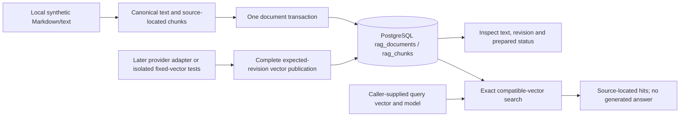

# Solution Whiteboard — Phase 3 AI engineering

<!-- sdd: whiteboard -->

| Field | Value |
| --- | --- |
| State | `DISCUSSION` |
| Need / issue | [Issue #8](https://github.com/hhhhhusky777/claims-data-lab/issues/8) |
| Owner | Repository owner hhhhhusky777 |
| Concluded design revision | `None` |
| Open owner decisions | Accept this offline-first design, workload and V1–V3/FC1–FC3; live model/budget decisions deferred |

## Discussion draft

| ID | Direction / fact | State |
| --- | --- | --- |
| DR1 | Owner authorized Phase 2 merge and moving to Phase 3 AI engineering | Main31d390f contains exactly the validated049b796 source tree |
| DR2 | Owner has OpenAI API quota but the API key is not ready | Provider selected; leave key empty; no live embedding/generation calls until configured |
| DR3 | Build correctness first, measure/improve later, stop after reviewed tasks for code reading | Existing project learning boundary retained |
| DR4 | Keep sequential and Spark importers; sequential remains default | Merged contract; Spark overhead issue#6 stays independent |
| DR5 | Propose an evidence-grounded Claims Operations Assistant | Proposed scope below, not yet accepted/frozen |
| DR6 | Owner requests implementing key-independent components first and leaving token blank | Prepare ingestion/chunking/storage/retrieval plumbing and offline tests; defer live embedding and generation |
| DR7 | Author recommends PostgreSQL with pgvector for document retrieval | Reuse PostgreSQL/Psycopg; separate document tables from imported payouts; exact setup/pins still require preflight |

## Current understanding and authority

The owner selected PostgreSQL+pgvector and OpenAI, then directed key-independent work first because the API key is unavailable. README/AGENTS retain Python, synthetic data, readable full implementation and task reading stops. Existing CSV/JSONL import, append-only payout semantics, shared writer and sequential default remain unchanged. Main is da3ea9c; the merged interview README is preserved. [PR #9](https://github.com/hhhhhusky777/claims-data-lab/pull/9) owns this delivery evidence.

This conclusion candidate delivers **Phase 3A: offline document and vector-store foundations**. It is not end-to-end RAG. Natural-language question embeddings, generated answers, prompt assembly/output evaluation, payout tools, model/SDK selection, paid calls, API/UI, Azure, Spark optimization and PDF/Word extraction remain later increments. No key or paid service is required by this delivery; OPENAI_API_KEY stays blank in examples and is not read by these commands.

The current policies.csv only maps P1/P2 to product names and supplies no policy terms. Add three clearly synthetic Markdown/text policy/operations fixtures for preparation examples. These do not represent Manulife rules or support eligibility/payment decisions.

## Research, alternatives and selected approach

Primary sources fetched: [pgvector](https://github.com/pgvector/pgvector) defines vector storage, exact nearest-neighbor search and cosine distance; [pgvector-python](https://github.com/pgvector/pgvector-python#psycopg-3) documents Psycopg3 registration; [PostgreSQL16 transactions](https://www.postgresql.org/docs/16/transaction-iso.html) supplies atomic updates and statement snapshots. Earlier [OpenAI embeddings](https://developers.openai.com/api/docs/guides/embeddings), [function calling](https://developers.openai.com/api/docs/guides/function-calling) and [structured outputs](https://developers.openai.com/api/docs/guides/structured-outputs) research informs later provider work, not permission to make calls now. [Microsoft RAG evaluation](https://learn.microsoft.com/en-us/azure/foundry/concepts/evaluation-evaluators/rag-evaluators) motivates separating retrieval plumbing from semantic and answer quality evidence.

| Option | Fit and cost | Disposition |
| --- | --- | --- |
| PostgreSQL+pgvector with existing Psycopg3 | One familiar database and transactions, real vector SQL; requires a server extension and Python adapter | Select; separate rag_* tables, no ANN index initially |
| Local vector files/custom similarity | Fewer services but duplicate persistence/search ownership and little PostgreSQL practice | Reject for this increment; pgvector already supplies exact cosine search |
| Hosted file search/Azure search | Hides some indexing internals, requires service resources and cost lifecycle | Defer |
| Local embedding model or keyword fallback | Could answer without an API key but adds a new model/backend/download or changes the retrieval being learned | Exclude; do not silently substitute for OpenAI |
| LangChain/agent framework | No current orchestration variation requires it | Defer; ordinary Python functions and existing libraries suffice |

## Proposed concluded design

| ID | Outcome and owning responsibility | Boundary / acceptance evidence |
| --- | --- | --- |
| D1 | Prepare explicit document_id plus one local .md/.txt file as canonical text and deterministic source-located chunks | UTF-8 with optional BOM; CRLF/CR normalized to LF; ≤1MiB raw input; no PDF/Word parsing or arbitrary directory crawl. V1; exact fixture spans/hash |
| D2 | Keep documents/chunks in separate PostgreSQL tables; preparation creates no embeddings | One document replacement transaction; unchanged canonical content/chunker preserves existing vectors, changed content invalidates them atomically; DB integration and rollback proof |
| D3 | Provide an embedding-publication API for later provider code, using expected document revision and a complete embedding set | No embedding generator or public embedding-upload CLI now. Model/dimensions recorded, no partial/stale publication. V2/FC2; controlled vectors only in isolated tests |
| D4 | Provide exact cosine retrieval API over compatible published vectors | Caller supplies vector and model; application validates query, SQL filters model/dimension and excludes prepared chunks. Stable tie order. V3; no ANN/index tuning, threshold, keyword fallback or semantic relevance claim |
| D5 | Add separate prepare/inspect CLI; document offline status and retain readable module/function boundaries | python -m claims_data_lab.rag; RAG_DATABASE_URL explicit, old importer does not import AI dependencies. Blank key has no effect; no ask command or fake answer |
| D6 | Run real PostgreSQL/pgvector integration with fixed labeled test vectors; retain measured operation evidence and fixture provenance | Offline component proof only. No model/answer accuracy claim. Proposed small local workload below; required project tests/runtime checks at existing gates |
| D7 | Reuse Python stdlib, Psycopg3 and shared logging/timing; provision owned cached/pinned local runtime safely | No ORM/queue/service/framework. Resolve exact pgvector server/adapter/dependency pins during setup after metadata/route preflight; do not assume an existing PG image contains extension |

### Document and chunk contract (D1)

The caller supplies a nonblank document_id, independent of filename. Read at most 1MiB+1 bytes to enforce the input bound before database mutation, decode utf-8-sig, normalize line endings, and hash the canonical UTF-8 text with SHA-256. This bound makes reading one whole small document deliberate; it is not a general large-file ingestion design.

Chunker version is chars-v1-1000. Starting at offset0, choose an end at most1000 Unicode code points later. If not at EOF, prefer the last newline in that range and include it; otherwise split at the character boundary. Advance to that end regardless; omit whitespace-only slices. Retain contiguous zero-based chunk_index, start/end code-point offsets (end exclusive), 1-based inclusive line_start/line_end of the slice, and exact canonical text slice. No overlap, heading interpretation or tokenizer dependency. An empty/whitespace-only document is valid with zero chunks; it remains prepared and cannot publish an embedding set.

A revision is (document_id, content_hash, chunker_version). This pins citations and later embeddings to the text and chunking contract; source paths are descriptive metadata, never a way to select arbitrary files for the model.

### Persistence, publication and retrieval (D2–D4)

| Table | Required fields / invariant |
| --- | --- |
| rag_documents | document_id TEXT primary key; source_path TEXT; canonical_text TEXT; content_hash TEXT; chunker_version TEXT; embedding_model TEXT nullable; embedding_dimensions INTEGER nullable. Both embedding metadata fields are absent while prepared |
| rag_chunks | document_id foreign key with cascade deletion, chunk_index INTEGER; start_offset/end_offset and line_start/line_end; chunk_text TEXT; embedding vector nullable. Composite primary key (document_id,chunk_index); no fixed vector dimension ties the design to an unselected model |

prepare/save locks or upserts the document row and serializes same-document replacements using PostgreSQL, without a custom lock service. New/changed revision replaces chunks and clears embedding metadata in the same transaction. Same revision preserves all embeddings/chunks and refreshes source_path metadata. No old prepared revision is kept as a searchable current revision. A save failure rolls back to the previously committed document/chunks/vectors. Use Psycopg's transaction context directly; the payout-specific transaction helper's file-reimport diagnostics do not fit this operation.

publish_embeddings accepts an expected revision, a nonblank embedding model identity and one vector per current chunk in chunk_index order. Validate a nonempty complete set, finite float32-representable numeric components (no booleans), common dimension and nonzero norm. Within a transaction, lock the current document, compare revision, and write the entire vector set plus model/dimension metadata atomically. Partial, malformed or stale sets do not replace an existing published set. A later model change replaces the whole set; no mixed models in a document. This is trusted application storage plumbing; test-only vectors live in disposable schemas and never claim to be semantic embeddings.

search_chunks accepts a finite nonzero query vector, the exact model identity and positive integer limit; vector dimensions must be supported by pgvector. The query compares only chunks whose document metadata matches model and dimension and whose vector is present, ordered by cosine distance then document_id/chunk_index. Use one SQL statement/snapshot for hit text, revision, spans and distance. load/inspect likewise reads a consistent document/chunk snapshot, avoiding separate reads that mix revisions. Return up to limit structured hits with revision/source spans/text/distance and an explicit search scope (model/dimension, published chunks only). Prepared or differently embedded documents are excluded. An empty result is a successful vector lookup, not proof that a natural-language question is unanswerable. No similarity threshold is invented before semantic evaluation.

All mutations own one short connection/transaction and perform no model calls while holding locks. Helpers bind values with Psycopg; table ownership and existing imported_payouts stay separate. This is a local synthetic single-user tool, not an enterprise authorization service. PostgreSQL handles serialization; there is no distributed writer or automatic retry. On ambiguous COMMIT, inspect document revision/readiness before retrying; original errors and operation context remain available.

### API and CLI responsibilities (D5/D7)

| Boundary | Contract |
| --- | --- |
| Pure document preparation | File→prepared document/chunks, no database/provider effects |
| Document store | Save prepared document; load consistent document snapshot; report prepared or vectors-present status derived from published metadata; zero chunks are prepared |
| Vector store | Publish expected-revision complete vectors; exact model/dimension-scoped search; no OpenAI calls |
| CLI/service composition | prepare --input PATH --document-id ID; inspect --document-id ID. Initialize owned rag tables/extension during documented setup, not during a read-only inspect. Print JSON document/revision/chunk/readiness metadata and source-located chunks for inspection |
| Optional AI dependencies | Separate requirements file for pgvector adapter/dependencies; do not add OpenAI SDK or require any API key for this delivery. Existing sequential CLI/base requirements stay usable |
| Diagnostics | Reuse standard logging/LoggerAdapter run_id and existing ImportMeasurements timers/snapshot where appropriate. Track document_id/revision, stage and original cause; do not log credentials/raw document bodies. No new telemetry service or timing framework |

The new CLI follows the existing project's exit convention:0 for successful prepare/inspect,2 for argument/missing RAG_DATABASE_URL errors,1 for file/database/operation failure. Missing document on inspect is an explicit not-found failure, not an empty successful document. CLI suppresses connection strings/raw database errors from its public error message; Python preserves original errors, with typed validation/stale-revision/not-found errors at their owning new boundary. V1–V3 own only the new validations below.



```mermaid
sequenceDiagram
    participant C as Caller
    participant P as Preparation
    participant DB as PostgreSQL
    C->>P: document_id and file
    P->>P: Bound, decode, normalize, hash and chunk
    P->>DB: Begin save; lock/upsert document
    alt Changed revision
        P->>DB: Replace chunks; clear vector metadata
    else Same revision
        P->>DB: Preserve chunks/vectors; refresh source path
    end
    P->>DB: Commit
    DB-->>C: Saved revision and prepared/vectors-present status
    Note over C,DB: A fatal write rolls back; uncertain COMMIT requires inspection
    C->>DB: Later publish expected revision and complete vectors
    alt Valid and current
        DB->>DB: Lock, atomically publish vectors and metadata
        DB-->>C: Publication committed
    else Invalid or stale
        DB-->>C: Reject publication; preserve committed state
    end
```

## Definition of Done and evidence boundaries

- Real synthetic .md/.txt files produce independently checked canonical text, hashes, contiguous chunk IDs and exact offset/line spans, including BOM/newlines, Unicode, long lines, whitespace-only input and bound/decoding failures.
- Real PostgreSQL+pgvector integration verifies prepared persistence, same-content preservation, changed-content invalidation, failure rollback and consistent snapshots. Isolate tests in owned private schemas; verify payout table and old CLI contracts remain unchanged.
- Real fixed-vector tests verify known cosine ranking/ties/model/dimension scoping, exclusion of unembedded chunks and atomic/stale publication. These are database plumbing tests, not semantic retrieval evaluation.
- prepare/inspect work with OPENAI_API_KEY empty/unset and report readiness honestly. Full applicable final suite includes existing PostgreSQL and Spark cases (not counted as passed skips), plus pgvector cases and pinned runtime validation.
- README explains new commands, document lifecycle, limits, optional requirements and future live work; manifest indexes the same canonical contracts. Exact pins, setup/download evidence, test results and task reviews belong in PR9.
- No paid calls, real embeddings, generated answers, semantic/answer-quality success, production capacity or complete JD coverage is claimed. Stop after each reviewed task; final implementation acceptance and main merge remain separate decisions.

## Workload, goals and remaining inputs

| Known information / source | Missing or uncertain input | Design impact | Recommendation / human decision |
| --- | --- | --- | --- |
| Small local learning project; no AI traffic/SLO target | Offline workload and evidence profile | Whole-document bound and exact search choice | Accept three synthetic documents, each ≤1MiB, one operation at a time; correctness first, no latency target. Record per-operation elapsed seconds and environment using shared timers; no throughput/capacity claim |
| OpenAI chosen; key unavailable | Live model IDs, account access and spend budget | Only later embedding/generation work | Defer all live-provider decisions/calls; offline foundation completion does not wait for key |
| PostgreSQL16 and Psycopg3 already used; cached images lack pgvector | Exact server extension/adapter/runtime pins and download route | Setup in storage task | Verify compatible pins and cache/direct mirrors before fetching; obey shared proxy allowance. No claim that setup or integration has already passed |

## Risks and recovery

| Risk | Handling / residual limit |
| --- | --- |
| Changed text paired with old vectors | D2 invalidates atomically; D3 compares full revision under document lock; no partial publication |
| Semantically irrelevant nearest neighbor | D4 returns distances/evidence only; fixed-vector tests do not establish relevance; live semantic evaluation deferred |
| Small-file bound/chunk boundaries | V1 explicit ≤1MiB domain; deterministic1000-character chunks may split sentences and are not token-budget tuning; later quality work may revise chunker version |
| DB/extension setup or COMMIT failure | Preserve cause/stage and prior committed state where known; inspect uncertain effects before replay; no auto retry |
| Scope drift | Broad RAG/provider/payout/API work remains later; no framework or fake backend introduced now |

## Canonical authority updates

| Design | Durable obligation | Live owner | Disposition |
| --- | --- | --- | --- |
| D1–D5 | Offline document format, revisions, atomic replacement/publication, exact retrieval and CLI scope | README Phase3 contracts/read-code sections | Add actual runnable contracts during implementation; preserve interview overview and planned labels |
| D6–D7 | Workload/evidence boundary, runtime setup and optional dependencies | README tests/performance/setup | Add real commands/pins/results meaning; detailed runs stay in PR |
| D1–D7 | Same authority owners; additional offline AI contracts/test entry points | Manifest inventory | Update links/gaps to delivered README, not feature state |
| D5 | Readable English code and task stops | AGENTS | No change; explicit owner full-code request already applies |

## KB coverage

| KB topic | Concrete design/work-method application | Coverage |
| --- | --- | --- |
| Architecture, scope, and assumptions | D1–D5 separate preparation, store and retrieval; scope excludes provider calls; small-file/workload premise explicitly offered for acceptance | Covered |
| Contracts and compatibility | D2/D5 preserve importer semantics and default; new CLI/dependencies separate; revision/source spans make new store behavior explicit | Covered |
| Efficiency and concurrency | Required independent reviewers read ready canonical sources while author researches; PostgreSQL serializes same-document mutations; no extra worker pipeline for small corpus | Covered |
| Error handling design | D2/D3 use atomic transactions, preserve prior state and original cause, reject stale publication; ambiguous COMMIT requires inspection rather than replay | Covered |
| Experience and learning | Current Experience has no entries; Phase2 source/receipts confirm reusable Psycopg/timing but not AI performance; task reading stops retained | Covered |
| Observability and diagnosability | D7 reuses logging/run_id and shared stage timers; errors retain document/revision/stage, no raw documents/credentials or second telemetry stack | Covered |
| Performance design | D6 proposes three small documents and serial operations, exact search and measured timings without SLO/capacity claim; later semantic quality/ANN optimization deferred | Covered; owner profile acceptance pending |
| Proportional review | Assess document revision/vector integrity and honest offline status; do not demand cloud, ANN scale, production security or live-answer evidence for this scope | Covered |
| Security basics | D1 explicit local files; SQL bound; separate owned tables/schema and synthetic data; no external disclosure/provider credentials, executable document instructions or public service | Covered |
| Simple design and reuse | D2/D4 reuse PostgreSQL/pgvector/Psycopg; D7 stdlib and existing measurement; no ORM, mapping DSL, agent framework, queue or substitute embedding model | Covered |
| Solution research | Official pgvector/Psycopg/PostgreSQL guidance supports storage/distance/transactions; alternatives compared; exact setup compatibility verified in owning task | Covered |
| Testing and reproduction | D6 real files/PGvector and independently known numeric vectors; unchanged-import regression and rollback/scoping tests; offline vs live claims separated | Covered |

## Draft-to-conclusion reconciliation

| Draft item | Design | Disposition / rationale |
| --- | --- | --- |
| DR1 | D1–D7 | Preserve merged Phase2; new Phase3A delivery on PR9 |
| DR2 | D5–D7 | OpenAI selected for later; no key dependency now |
| DR3 | D5/D6 | Readable implementation and stop after each task retained |
| DR4 | D5 | Importers/default preserved; issue6 independent |
| DR5 | D1–D6 | Deliver foundation first; complete assistant later |
| DR6 | D1–D7 | Key-independent preparation/store/retrieval plumbing now; prompt/output/provider work later increment |
| DR7 | D2–D4/D7 | Select PostgreSQL+pgvector; exact search, setup preflight |

## Newly introduced validations

| ID | Validation / authority / execution boundary | Protected outcome / risk / marginal value | Concrete invalid case | Failure effect / recovery | Cost / risk reduction | Existing or cheaper mechanism / coverage / why insufficient | Fail-close / test reference | Owner disposition |
| --- | --- | --- | --- | --- | --- | --- | --- | --- |
| V1 | D1/D5 document preparation and new CLI: nonblank ID, .md/.txt, valid UTF-8, ≤1MiB; inspect requires existing ID | Bounded real text/provenance; avoid unsupported format or fictitious document success | A PDF or >1MiB file, or inspecting absent ID | No document mutation; owner supplies supported input/ID then retries | Bounded read and stdlib checks; no new parser framework | Existing payout readers own different formats/locations; cannot parse document text; reuse argparse/file decoding and DB not-found lookup | FC1; real-file/CLI boundary tests | Pending |
| V2 | D2/D3 publication: complete current-revision vectors; nonblank model, finite representable components/common dimension/nonzero norm | Avoid stale text/vector pairing, mixed/incomplete publication and undefined cosine distance | Caller embeds revisionA, document becomes revisionB before publication | Reject entire set, preserve current state; caller reloads B and recomputes complete set | One row lock/linear vector check; no retry service | Transactions ensure atomicity, but cannot identify stale semantic revision; add expected-revision comparison and reuse pgvector adaptation | FC2; stale/invalid/rollback integration | Pending |
| V3 | D4 search: nonblank model, finite nonzero supported vector and positive integer limit | Coherent scoped cosine query; invalid caller input is not empty successful retrieval | Zero query vector or limit0 | Reject query; caller supplies compatible vector/model/positive limit | Small input checks; no similarity threshold | pgvector handles vector math/type limits; API owns model/safe query contract; no new ranker | FC3; numeric ranking/scoping/query-boundary tests | Pending |

## Newly introduced fail-closed behaviors

| ID | Trigger | Required response | Concrete example | Impact | Recovery / best next action | Owner disposition |
| --- | --- | --- | --- | --- | --- | --- |
| FC1 | V1 unsupported input/absent inspection ID | Stop requested operation; no successful document result or mutation | prepare receives a PDF | That operation fails; existing records remain | User supplies UTF-8 .md/.txt ≤1MiB and nonblank ID, or selects existing ID; then retry | Pending |
| FC2 | V2 malformed/incomplete/stale publication | Publish nothing; preserve current committed revision/vector set | RevisionA's vectors arrive after revisionB is saved | New vectors rejected; B remains prepared/current | Caller reloads B, obtains complete compatible vectors and republishes against B; uncertain COMMIT inspected first | Pending |
| FC3 | V3 invalid vector query | Do not return fabricated/empty-success search | Query vector is all zeros | Query fails; documents unchanged | Caller supplies nonzero finite compatible vector/model and positive limit; then repeat read | Pending |

These are new API/CLI rejection contracts, not additional delivery gates. Existing transaction failures, extension/runtime absence and download policy retain their owning boundaries. Ordinary tests remain under the project's existing validation gates.

## Design amendments / human brief

No frozen design yet. Owner acceptance follows exact-candidate approval by both fresh retained reviewers, then a metadata-only conclusion transition verified by them before task planning. HUMAN_DECISION: accept D1–D7, proposed workload and V1–V3/FC1–FC3. DISCLOSE: offline component completion only, no live semantic/answer proof. AGENT_ACTION: plan and implement after acceptance. NONE: implementation/paid-call/merge authority inferred from this document alone.
