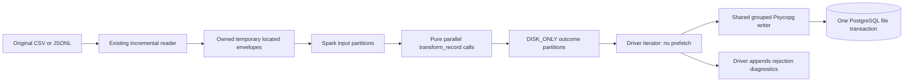

# Solution Whiteboard — Spark transformation experiment

<!-- sdd: whiteboard -->

| Field | Value |
| --- | --- |
| State | `DISCUSSION` |
| Need / issue | [Issue #4](https://github.com/hhhhhusky777/claims-data-lab/issues/4) |
| Owner | Repository owner hhhhhusky777 |
| Concluded design revision | `None` |
| Open owner decisions | Accept proposed D1–D6, bounded workload/resources and V1/FC1 after independent review |

## Discussion draft

| ID | Agreed item, alternative, constraint, or gap | State / resolution |
| --- | --- | --- |
| DR1 | Owner selected Spark transformation first, retaining the PostgreSQL writer | D1; proposed |
| DR2 | Accepted 100k/1M rows, 500-row groups and three repeats; dataset/resource details were open | D5 supplies proposed bounded assumptions, without a speed target |
| DR3 | CSV multiline framing and JSON native types/source numbers must survive distribution | D2 reuses readers and stages located records; native Spark parsing deferred |
| DR4 | Driver iteration alone does not prove concurrent transformation | D3 materializes disk-persisted results in parallel before driver iteration |
| DR5 | Stop after each reviewed implementation task for code reading | D6; preserved; no Autopilot authority |

## Current understanding and authority

The learning outcome is a working parallel transformation path and an honest comparison with the sequential importer. A speedup is a hypothesis, not an acceptance condition. Phase 1 is merged at `3481fd8213290abbdce890dc62eeeeb1b3811360`; its [complete design](archive/phase-1-postgresql-transform.md), [README](../../README.md), [AGENTS](../../AGENTS.md) and [manifest](project-adoption-manifest.md) remain authoritative. The code at this base separates readers, conversion, inserts and transaction ownership.

In scope: deterministic synthetic files, sequential baseline, local classic PySpark transformation, one existing PostgreSQL writer, correctness comparison and repeated measurements. Out of scope: distributed database/sharding, JDBC partition writes, producer/consumer overlap ([issue #3](https://github.com/hhhhhusky777/claims-data-lab/issues/3)), COPY, cloud, streaming, Spark SQL query exercises and AI. These remain later increments.

Current checks on 2026-11-24: Python 3.12.9 is installed; all 18 transformation tests pass in this worktree on it. Java is absent; no Spark runtime is installed here. Available disk was approximately 22 GiB; this observation is not a resource guarantee. Initial restricted hardware discovery was denied; a read-only host check then verified 16 GiB physical RAM and 10 logical CPUs. These capacities are not exclusive allocations or proof of free memory. Installed playbook pin equals upstream main `d038cdb`; installer validates CURRENT. No product code or runtime-package download has started.

## Research, alternatives and tradeoffs

| Option | Fit / cost | Proposed disposition |
| --- | --- | --- |
| Existing sequential reader/converter/writer | Lowest overhead; established semantics; no distributed transformation | Retain default and baseline |
| Native Spark CSV/JSON schemas and casts | Direct distributed read, but parser/cast semantics and logical CSV numbering differ; replacing validation would duplicate its owner | Defer until a separately justified contract-compatible design |
| Existing readers → located disk envelopes → pure partition conversion → existing writer | Reuses exact parsing/conversion, keeps driver input memory incremental; adds serial staging, disk I/O and Python serialization | Select for this bounded transformation experiment, without claiming parallel parsing |
| Parallel JDBC or executor-side Psycopg | Could load concurrently; changes atomicity/retry ownership | Exclude; only driver may touch PostgreSQL |
| Transform lazily only through toLocalIterator | Simple consumption, but does not itself establish overlapping tasks | First materialize all transformation partitions using a Spark action and DISK_ONLY persistence |

Primary sources consulted: [Spark 4.0.4 RDD guide](https://spark.apache.org/docs/4.0.4/rdd-programming-guide.html), [RDD iteration](https://spark.apache.org/docs/4.0.4/api/python/reference/api/pyspark.RDD.toLocalIterator.html), [CSV behavior](https://spark.apache.org/docs/latest/sql-data-sources-csv.html), [installation requirements](https://spark.apache.org/docs/4.0.1/api/python/getting_started/install.html), [psutil RSS/process API](https://psutil.readthedocs.io/stable/), and Python's standard logging/time APIs. Version-specific 4.0.4 installation/dependency metadata must be checked during setup; no compatibility is inferred solely from latest docs.

## Proposed design

| Design point | Outcome and owning responsibility | Boundaries / evidence |
| --- | --- | --- |
| D1 | CLI gains optional `--engine sequential|spark`, default sequential; Python API retains existing calls | Sequential use does not import or require Spark; same stdout counts, exits and append contract |
| D2 | A Spark source adapter streams existing read_csv/read_jsonl outputs into an owned temporary JSONL envelope file, then closes it before Spark reads it | Encode the complete SourceRecord or RejectedRecord, preserving source_file, source_record, input_format, native JSON values and ignored extras. JSON escaping keeps a multiline source record on one envelope line. This is serial parsing/staging, not distributed ingestion |
| D3 | Spark classic RDD textFile reads the envelope with minPartitions=8; pure mapPartitions converts SourceRecord through existing transform_record and passes parser rejections through | Workers have no DB handles, credentials, reject-output handles or side effects. Catch only RowValidationError as a row rejection. Persist converted outcomes DISK_ONLY; a full action materializes partitions before reading them back. Record actual partitions and task overlap; minPartitions is a request, not a memory ceiling |
| D4 | Driver consumes converted outcomes through toLocalIterator(prefetchPartitions=False) and the shared Phase 1 writer loop | Extract only the currently duplicated orchestration needed to accept an iterator of ImportedPayout or RejectedRecord. Keep one driver-owned file transaction, 500-row groups and final partial group. Source and reject alias protections remain. Full iterator completion and output close precede commit. Workers may recompute pure conversion without duplicating DB writes |
| D5 | Benchmark both engines with explicit workloads, intervals, environment and correctness evidence | Detailed profile and proposed resources below. No numeric improvement threshold or automatic engine replacement |
| D6 | Keep implementation readable, provision worktree-local runtime and stop at each reviewed task | Proposed learning sequence: deterministic generator/sequential benchmark; Spark adapter/shared writer; comparative runs/interpretation. Actual decomposition/DoD follows accepted design. Final implementation acceptance and protected-target merge remain separate decisions |



The temporary envelope and Spark disk cache belong to this invocation, under an owned temporary directory. Clean both on success or failure, unpersist and stop the owned Spark session, and never remove original inputs or another run's files. Ordinary cleanup errors must not hide the original failure. Local execution permits a local file URI; a multi-machine cluster would need shared storage and packaging and is explicitly unproven here. No remote cluster endpoint is exposed.

The Spark source is lazy until the common writer consumes it: reject/input alias checks happen first. Source preparation, transformation and driver iteration all execute inside the file transaction, so fatal failures remain under the existing rollback boundary. This trades a longer transaction for the unchanged one-file contract. Expected row rejects remain located diagnostics; their order and generated database IDs are not parity keys. On a fatal run no completeness guarantee is made for diagnostic contents, as in Phase 1.

```mermaid
sequenceDiagram
    participant CLI
    participant Driver
    participant Spark
    participant PG as PostgreSQL
    CLI->>Driver: Engine and existing import arguments
    Driver->>PG: Begin transaction; ensure table
    Driver->>Driver: Protect input; open rejects; stage reader outcomes
    Driver->>Spark: Partition conversion; DISK_ONLY; materializing action
    Spark-->>Driver: Pure results persisted; task evidence
    loop Iterate cached outcomes without prefetch
        Spark-->>Driver: Payout or row rejection
        Driver->>PG: Insert full/final groups
    end
    Driver->>Driver: Close rejects and source resources
    Driver->>PG: Commit once
    Driver-->>CLI: Committed counts
```

Failure handling reuses Phase 1: expected parser/conversion errors continue as RejectedRecord; fatal reader, disk, Spark, output or database failures propagate their causes and stage context, abort and roll back, and never fall back silently to sequential. An interrupted COMMIT still requires operator database inspection before retry. Input failure, missing Java or missing Spark is an import failure, not a row rejection. Spark task retry/recomputation is acceptable only because tasks are pure; the application never automatically repeats database imports. Stage and run context identify the source operation while keeping database credentials out of Spark configuration, worker closures and logs.

## Workload and measurement proposal (D5)

| Concern | Proposed reproducible boundary |
| --- | --- |
| Accepted starting profile | 100,000 and 1,000,000 rows; 500-row insert groups; three measured runs per size, format and engine; one importer and one isolated PostgreSQL instance |
| Dataset | Generate equivalent CSV/JSONL from a deterministic formula and seed 42, with i=0..N-1: payout_id T(i mod 50000), version 1+(i mod 5), policy_id P(i mod 10000), date 2026-11-18, currency USD, amount_cents ((i*7919+42) mod 200001)-100000. No injected invalid records in throughput runs. Small correctness fixtures separately cover malformed input, types and multiline CSV. Record exact byte sizes and hashes |
| Runtime | Python 3.12.9 already installed; propose PySpark 4.0.4 classic and JDK 17, same Python for both engines. Pin exact SDK/transitive dependencies and Java distribution/build at setup from verified available sources; retain base Psycopg 3.3.2. Setup preflights mirror/route/size and global download allowance before any runtime fetch |
| Local Spark | local[2], eight requested partitions, 1 GiB configured driver JVM heap; Python workers and native memory are additional, not covered by the heap setting. Capture actual resources, settings, partition counts/sizes and process memory |
| PostgreSQL | Reuse cached PostgreSQL 16-alpine image by verified digest, owned disposable container on a loopback ephemeral port; proposed container limit 1 CPU and 1 GiB, fresh private schema per measured run. Record Docker VM and database settings; preserve unrelated stacks |
| Timing | One fresh importer process per run, no reused Spark session. End-to-end process launch to successful exit includes startup, staging, transformation, transfer, inserts, commit and cleanup; data generation, schema reset and post-run correctness checks are outside this interval. Time internal startup/staging/materialization/driver consumption and SQL calls/commit separately with monotonic clocks. Driver consumption includes transfer/iteration and SQL, so SQL is a nested interval, not an additive independent stage |
| Instrumentation | Extend existing Python standard logging with one run_id and stage context, using its shared handlers/adapters; Spark event logs provide native task/stage timing. A benchmark supervisor uses psutil process APIs to sample importer plus descendant Python/JVM RSS every 100 ms. Report the maximum observed sum as sampled process-tree RSS, not an exact peak or unique physical footprint; DB/container memory is separate. No monitoring service or custom telemetry framework |
| Run method | Generate once, reuse identical files; one unmeasured warm-up per engine/format on a small fixture, then three alternating engine pairs per size/format. A fresh process means Spark startup remains included. Cache state is uncontrolled OS/DB warmth, disclosed rather than called cold cache. No concurrent benchmark jobs |
| Evidence | Per run record commit, full nonsecret command/config, engine, format, bytes, rows, counts, intervals, accepted rows/second, sampled RSS, failures, partition/task identifiers and actual overlap. Keep ignored local artifacts; sanitized concise results in PR. Preserve all three observations plus median/range, without cherry-picking |
| Correctness | Compare complete stored value multisets between engines after each pair, excluding generated id but including source_file/source_record and duplicate multiplicity; use streaming comparison or database EXCEPT ALL, not count/sum alone. Compare located rejection multisets on correctness fixtures. Verify one-file rollback after an earlier inserted group and reader/output/worker failures |
| Interpretation | Local parallel tasks teach Spark execution; they do not prove multi-node scaling. Parsing, transfer or PostgreSQL may dominate. Staging/materialization costs count against Spark. A slower Spark result is valid evidence and the sequential default stays |

Memory remains dependent on the largest record and largest Spark result partition plus the writer batch, JVM and worker overhead. DISK_ONLY does not provide a hard RAM ceiling; toLocalIterator may need a whole partition. Record largest partition rows/serialized bytes as explanatory sizes, not an RSS bound. The resource profile is a bounded local experiment, not a claim that it handles arbitrary files or production traffic. If the host cannot run the profile, disclose the actual limit and seek a profile amendment before comparing incompatible runs.

## Canonical authority updates

| Design ID | Durable constraint or decision | Canonical source | Required update and rationale |
| --- | --- | --- | --- |
| D1–D4 | Optional engine, compatibility, pure worker boundary and Spark memory/staging contract | README import/transaction/read-the-code sections | Document actual option, ownership, setup and memory difference when implemented |
| D5 | Reproducible workload, measurement intervals/resources and honest acceptance interpretation | README Performance Goals and Evidence | Extend existing authority with accepted profile, commands and evidence meaning; no duplicate performance-policy file |
| D1–D6 | Same project authorities; performance workload no longer wholly unspecified | Manifest authority inventory and validation gaps | Correct stale performance gap now; retain design/task progress outside manifest |
| D6 | English learning code and task stops | AGENTS | No change: existing scope and explicit owner instructions suffice |

## KB coverage

| KB topic | Design decision or work-method application and reference / non-applicability reason | Coverage state / open gap |
| --- | --- | --- |
| Architecture, scope, and assumptions | D1–D4 separate parser, pure workers and writer; D5 explicitly bounds local runtime/resources and unproven cluster behavior | Covered; owner profile acceptance pending |
| Contracts and compatibility | D1 defaults to existing engine; D2/D4 preserve locations, native types, append and file transaction; compare multisets rather than generated ids | Covered |
| Efficiency and concurrency | Worktree setup and source research use ready inputs; independent design reviews use separate sessions. D3 materialization exposes multiple schedulable tasks; no concurrent DB writers | Covered |
| Error handling design | Existing transaction and typed row rejection reused; Spark/disk errors abort with cause/context; workers pure; uncertain COMMIT inspection unchanged | Covered |
| Experience and learning | Manifest-linked Experience inspected: no entries. Phase 1 code and archive supply verified contracts; no inferred bottleneck from past storage work | Covered |
| Observability and diagnosability | D5 extends standard Python logging/run context, Spark event logs and mature psutil sampling; stage intervals, SQL nesting, memory interpretation and redaction explicit | Covered |
| Performance design | D5 keeps accepted row/repeat/group profile; new dataset/resources/evidence proposed for acceptance before dependent benchmark work; no promised speedup | Covered; owner profile acceptance pending |
| Proportional review | Compare simple sequential/native parsing/staged reuse; review actual parity, measurement and ownership risks without demanding production infrastructure | Covered |
| Security basics | Synthetic files only, owned local temp/cache and loopback PostgreSQL; driver retains credentials; no credentials in Spark closures/config or committed artifacts | Covered |
| Simple design and reuse | D2/D3 reuse readers/transform_record; D4 extracts one common writer path; no mapping DSL, queue, second writer or new database | Covered |
| Solution research | Primary Spark parser/iteration/persistence and installation docs inform alternatives; D3 task-overlap and D5 parity/measurements test project applicability | Covered |
| Testing and reproduction | D5 uses real files, Spark tasks and PostgreSQL at owning boundaries; independent expected values, type/multiline/reject/rollback cases; source and environment tied to results | Covered |

## Newly introduced validations

Existing input, type, reject-alias and transaction validations remain in the Phase 1 contract. Missing runtime and resource/I/O failures reuse the existing fatal-import boundary; no new retry or schema-admission gate is added. Comparison tests and parallel-task evidence are ordinary acceptance evidence under the existing final validation gate.

| ID | Validation, owning authority, and execution boundary | Protected outcome / risk and marginal value beyond existing controls | Concrete invalid case | Failure effect / recovery | Cost / risk reduction | Existing/reusable or cheaper mechanism, its coverage, and why insufficient | Fail-close / test reference | Owner disposition |
| --- | --- | --- | --- | --- | --- | --- | --- | --- |
| V1 | D1 engine selector; CLI argparse boundary, before import | Prevent ambiguous engine selection; default remains sequential | --engine sparkk | Exit 2 before import; operator corrects to sequential or spark and reruns | One argparse choices declaration; no new dependency | Reuse existing argparse validation; Phase 1 has no engine selector, so add only its two choices | FC1; CLI engine test | Pending |

## Newly introduced fail-closed behaviors

| ID | Trigger | Required fail-closed response | Concrete example | Impact | Recovery / best next action | Owner disposition |
| --- | --- | --- | --- | --- | --- | --- |
| FC1 | Engine value outside sequential/spark | Existing CLI argument-error exit 2 before import | --engine sparkk does not start a database import | No input or DB changes | Operator corrects the value and reruns; no data reconciliation needed | Pending |

## Draft-to-conclusion reconciliation

Not concluded. DR1–DR5 map to proposed D1–D6 above; no implementation plan or product changes are authorized by this discussion document alone. Owner acceptance and independent review must precede the metadata-only freeze transition.
