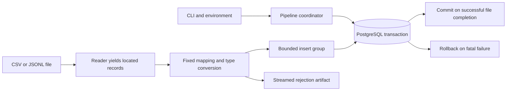

# Solution Whiteboard — Claims Data Lab

<!-- sdd: whiteboard -->

| Field | Value |
| --- | --- |
| State | `DISCUSSION` |
| Need / issue | Phase 1 input-format transformation scaffold |
| Owner | Repository owner hhhhhusky777 |
| Concluded design revision | `None` |
| Open owner decisions | Accept the concrete schema, transaction and validation choices below |

## Discussion and reconciliation

| ID | Owner direction / earlier option | Resolution |
| --- | --- | --- |
| DR1 | Learner implements annotated module/class/function skeletons | D1 retained |
| DR2 | First correctness, then performance, then remaining knowledge areas | D2 retained |
| DR3 | Earlier SQLite reporting, update versions and duplicate detection | D3 supersedes with PostgreSQL transformation only, as explicitly requested |
| DR4 | Large inputs and bounded memory | D4 incremental reading and bounded insert groups |
| DR5 | PySpark queries and processing | Deferred until distributed processing work |

## Proposed concluded design

| ID | Outcome and boundary | Acceptance evidence |
| --- | --- | --- |
| D1 | Deliver English annotated Python signatures, typed data containers and NotImplementedError bodies for the learner. Runtime implementation is later learner work. | Import/compile scaffold and inspect that behavior remains unimplemented |
| D2 | Phase 1 runtime goal is CSV/JSONL to PostgreSQL, verified using SQL. Performance and extra features follow a correct baseline. | Integration tests query actual inserted columns and counts when learner code exists |
| D3 | Python 3.11+ with Psycopg 3. One input file per invocation. Plain inserts preserve every accepted record, including repeat IDs and versions. Each rerun imports the file again. No business-key merge, ordering, deduplication, policy reference check, financial aggregation or HTTP service. | Two rows with the same payout_id remain two rows |
| D4 | Sequential reader, transformer and writer in one process. Read one CSV logical record or JSONL line at a time, buffering at most configurable batch_rows transformed records. Document memory as O(largest record + bounded batch), not a hard byte ceiling. No producer queue or disk spool. | Reader iteration and batch-boundary tests, including final partial batch |
| D5 | Writer owns one PostgreSQL transaction per input file. Insert groups use executemany with bound parameters. Successful completion commits all accepted rows; fatal read or database failure rolls back the file. Preserve original exception causes. | Inject failure after an earlier insert group and verify no new rows survived |
| D6 | Expected conversion/validation failures produce a streamed JSONL rejection artifact with source path, record number and reason. They do not abort other valid records. Fatal errors close the artifact and mark the command failed. Rejection artifact is diagnostic, not an atomic database output. | Malformed JSON, missing field and invalid date are rejected with locations |
| D7 | CLI supplies input path, csv/jsonl format, batch_rows and reject path. Credentials come from DATABASE_URL environment variable. Validate positive batch_rows. No committed credentials; use synthetic fixtures and local development PostgreSQL only. | Invalid options fail before inserts; CLI reports outcome and committed inserted/rejected counts |

### Target schema and mapping

Use one fixed table `imported_payouts` for the first exercise. Map fields by name. A small fixed mapping has one conversion per column; no generic configuration engine.

| Column | PostgreSQL type | Input / conversion |
| --- | --- | --- |
| id | BIGINT GENERATED ALWAYS AS IDENTITY PRIMARY KEY | Database-generated technical ID |
| source_file | TEXT NOT NULL | Source path |
| source_record | BIGINT NOT NULL | 1-based CSV logical data record or JSONL physical line |
| payout_id | TEXT NOT NULL | Required nonempty input string |
| version | BIGINT NOT NULL | Required integer input, opaque payload; never used to order or merge |
| policy_id | TEXT NOT NULL | Required nonempty input string; no relationship validation |
| settled_on | DATE NOT NULL | Input YYYY-MM-DD string converted to date |
| currency | TEXT NOT NULL | Required nonempty input string; no external currency registry check |
| amount_cents | BIGINT NOT NULL | Signed integer cents from input |

CSV opens with utf-8-sig and newline=''. JSONL opens with utf-8-sig. Ignore extra fields. Require named columns in CSV header, allowing any order. CSV integer values use signed decimal integer text. JSON integer values must be actual integers, excluding booleans; both must fit PostgreSQL BIGINT. Missing/null required values are row errors. JSONL non-object values and blank lines are row errors. A malformed CSV stream or missing required CSV header aborts the file, because reliable record boundaries or mappings are unavailable. Existing JSONL samples are raw examples; add a payout CSV counterpart with known transformed values during scaffold fixture work. `policies.csv` is retained reference data and is outside this import's target contract.

### Architecture and behavior

Reader owns file decoding and record locations. Transform owns column conversion and required-field checks. Database writer owns inserts and transaction lifetime. Pipeline owns coordination and result counts. CLI owns argument handling and redacted failure display. Models hold typed input locations, rejected rows, transformed rows and run results. Use functions and data containers; no repository base classes or plugin framework. The database connection and files are explicitly closed.

## Research and alternatives

Psycopg transaction contexts support the selected commit/rollback boundary. executemany accepts multiple parameter sets; COPY is a later measured optimization. Sources read 2026-11-19: https://www.psycopg.org/psycopg3/docs/basic/transactions.html and https://www.psycopg.org/psycopg3/docs/api/cursors.html . PostgreSQL is owner-selected. Streaming instead of loading the file bounds memory independently of file length, subject to largest-record size. A queue adds coordination without a current throughput requirement. Per-group commits were rejected for this baseline because they leave partial files after failure. Very large file transactions may be expensive; revisit that boundary during measured performance work.

## KB coverage

| KB topic | Concrete application | State |
| --- | --- | --- |
| Architecture, scope and assumptions | D3 consumes records as supplied; opaque version fields confer no upstream semantics | Covered |
| Contracts and compatibility | Fixed target schema and mapping above; obsolete README business semantics must be replaced | Covered |
| Efficiency and concurrency | Sequential D4 avoids queue coordination; independent design reviews run separately | Covered |
| Experience and learning | Existing project Experience has no lessons; consult it and preserve verified lessons when implementation supplies evidence | Covered |
| Performance design | D2/D4 establish a bounded baseline; no numeric throughput goal or optimization claim | Covered |
| Security basics | D7 environment credentials and synthetic data; rejection artifacts remain local and ignored | Covered |
| Simple design and reuse | Standard csv/json and Psycopg, one table and fixed mapping; no framework | Covered |
| Solution research | Official Psycopg sources support transaction and grouped-insert choices | Covered |
| Testing and reproduction | Compare real database values; fatal insert failure after an earlier group tests rollback | Covered |
| Error handling design | D5/D6 separate expected rejected records from fatal rollback and retain causes | Covered |
| Observability and diagnosability | CLI outcome, record locations, rejected counts and stage-aware errors via Python logging; no credentials in logs | Covered |

## Canonical authority updates

| Design | Canonical owner | Required update |
| --- | --- | --- |
| D2-D7 | README Phase 1 | Replace SQLite/report/replay contract with agreed PostgreSQL transformation contract during scaffold delivery; preserve later roadmap |
| D1 | AGENTS.md | Existing learner-implementation boundary already covers this outcome |
| D2-D7 | Adoption manifest authority links | Reconcile obsolete report and version references with README, retaining installed pin and adoption boundaries |

## Newly introduced validations

| ID | Validation / authority / execution boundary | Protected outcome / risk / marginal value | Concrete invalid case | Failure effect / recovery | Cost / risk reduction | Existing or cheaper mechanism / coverage / why insufficient | Fail-close / test reference | Owner disposition |
| --- | --- | --- | --- | --- | --- | --- | --- | --- |
| V1 | D3/D6 required-field and type checks at transformation; framing/header checks at reader | Produce the promised table format and useful rejects | amount_cents is 'abc'; required CSV header absent | Row error is rejected and processing continues; framing/header failure aborts and rolls back; operator fixes source and reruns | Standard parsing and small schema checks prevent unusable rows | PostgreSQL checks types but cannot supply source-record diagnostics before batched failure | D5/D6 integration rejection and rollback tests | Pending |
| V2 | D4/D7 positive batch_rows at CLI | Prevent an invalid buffer configuration | batch_rows=0 | Reject command before inserts; operator sets positive value | One argument check | Database cannot validate client buffer configuration | CLI validation test | Pending |

## Newly introduced fail-closed behaviors

| ID | Trigger | Response | Concrete example | Impact | Recovery / best next action | Owner disposition |
| --- | --- | --- | --- | --- | --- | --- |
| FC1 | Fatal read, missing header, reject-output failure or database exception during a file | Abort and roll back its inserts; preserve error cause and report failure | Connection fails after the first insert group | This file has no committed inserts if rollback is confirmed; a connection loss during COMMIT may leave outcome unknown | Operator fixes dependency/input and checks PostgreSQL before repeating an ambiguous COMMIT; a confirmed rollback may be rerun | Pending |

## Material assumptions

| Assumption | Category | Evidence / handling | Impact if false |
| --- | --- | --- | --- |
| None | None | Supported input and operational boundaries are explicitly defined above | None |

## Human brief

This is the exact proposed Phase 1 contract for review. PostgreSQL integration, CLI runtime and tests remain learner implementation. Design review approves the schema, memory/transaction boundaries, V1/V2 and FC1 before conclusion. Later scaffold delivery provides annotated stubs and fixtures. No plan or product implementation is present yet.
