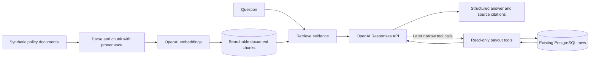

# Solution Whiteboard — Phase 3 AI engineering

<!-- sdd: whiteboard -->

| Field | Value |
| --- | --- |
| State | `DISCUSSION` |
| Need / issue | [Issue #8](https://github.com/hhhhhusky777/claims-data-lab/issues/8) |
| Owner | Repository owner hhhhhusky777 |
| Concluded design revision | `None` |
| Open owner decisions | First increment, corpus/workload, model and live-call budget; concrete contracts before implementation |

## Discussion draft

| ID | Direction / fact | State |
| --- | --- | --- |
| DR1 | Owner authorized Phase 2 merge and moving to Phase 3 AI engineering | Main31d390f contains exactly the validated049b796 source tree |
| DR2 | Owner has OpenAI API quota but the API key is not ready | Provider selected; leave key empty; no live embedding/generation calls until configured |
| DR3 | Build correctness first, measure/improve later, stop after reviewed tasks for code reading | Existing project learning boundary retained |
| DR4 | Keep sequential and Spark importers; sequential remains default | Merged contract; Spark overhead issue#6 stays independent |
| DR5 | Propose an evidence-grounded Claims Operations Assistant | Proposed scope below, not yet accepted/frozen |
| DR6 | Owner requests implementing key-independent components first and leaving token blank | Prepare ingestion/chunking/storage/retrieval plumbing and offline tests; defer live embedding and generation |
| DR7 | Author recommends PostgreSQL with pgvector for document retrieval | Reuse PostgreSQL/Psycopg; separate document tables from imported payouts; exact setup/pins still require preflight |

## Current understanding and authority

README and AGENTS own import and learning contracts. Existing imported_payouts contains source-located append-only records, not a reconciled current-state claims ledger. Reimports and repeated payout IDs remain separate rows; version is opaque payload and amounts may be negative. Do not silently infer final claim status, latest version, deduplication, eligibility or payment decisions.

The only policy reference currently supplied is fixtures/policies.csv: P1→Travel and P2→Home. It contains no policy terms, exclusions or eligibility evidence. Create explicitly synthetic learning documents before demonstrating policy Q&A; do not invent policy rules from those two labels or present the demo as Manulife's system.

Normal delivery applies because AI introduces document/index, model, output, cost and error contracts. This is the active discussion source; no implementation plan, frozen design, product code or accepted DoD exists yet. Phase 2 sources are in [its archive](archive/phase-2-spark-transform.md), with results/merge evidence in [PR #5](https://github.com/hhhhhusky777/claims-data-lab/pull/5).

## Proposed learning system

Build in small increments:

1. **Policy retrieval and cited answers:** ingest real synthetic Markdown/text files, retain document identity/hash/source spans, chunk, call embeddings, store searchable chunks, retrieve evidence, and generate structured answers with citations or insufficient-evidence status.
2. **Read-only payout tools:** give the model narrow typed tools to retrieve records and calculate explicitly scoped summaries using parameterized PostgreSQL. Keep exact values/currencies in application-controlled fields. Explain imported rows rather than claim deduplicated business totals.
3. **Evaluation and serving improvements:** evaluate retrieval separately from answers; add a small local API only once the CLI works. UI, cloud/Azure adapters, advanced reranking and broader agent workflows remain later options.

The recommended retrieval store is PostgreSQL with the pgvector extension, in separate document/chunk tables alongside the existing payout table. RAG is the application workflow, not the database. The complete first-increment contracts still need conclusion before dependent code.

## Research and options

Official OpenAI documentation was fetched for [embeddings](https://developers.openai.com/api/docs/guides/embeddings), [function calling](https://developers.openai.com/api/docs/guides/function-calling) and [structured outputs](https://developers.openai.com/api/docs/guides/structured-outputs). It supports using the official Python SDK for embeddings, application-executed tool calls and schema-shaped responses. Structured shape does not establish factual truth or valid citations. Exact SDK/version/model compatibility remains setup work after selection, not an inferred account entitlement.

Microsoft's [RAG explanation](https://learn.microsoft.com/en-us/azure/foundry/concepts/retrieval-augmented-generation) informs retrieval→context→generation. Its [RAG evaluators](https://learn.microsoft.com/en-us/azure/foundry/concepts/evaluation-evaluators/rag-evaluators) distinguish retrieval quality, groundedness, relevance and completeness. These concepts apply locally without requiring an Azure subscription or evaluator service.

| Option | Fit / trade-off | Proposed disposition |
| --- | --- | --- |
| Official OpenAI SDK, explicit Python orchestration | Makes embedding/retrieval/tool/output steps visible for learning; account quota is available per owner | Prefer; no additional orchestration framework initially |
| PostgreSQL + pgvector | Reuses database operation skills; [pgvector-python](https://github.com/pgvector/pgvector-python) supports Psycopg3; needs server extension and deployment/version preflight | Recommended store; exact pins/setup and complete design acceptance pending |
| Small local exact-vector store | Fewer services, useful small-corpus baseline; separate persistence and vector math | Compare with pgvector before concluding; no custom ANN engine |
| Hosted file search | Less indexing code; hides some chunking/storage work and adds hosted-resource lifecycle/cost | Alternative if learning priority changes |
| Azure AI Search / Azure model service | Closer to JD platform, adds account/deployment prerequisites | Later adapter; owner currently selected OpenAI |
| LangChain / larger agent framework | Additional abstractions before a demonstrated need | Defer initially |

## API-key-independent implementation order

Owner requested building other components while the API key is unavailable. Keep OPENAI_API_KEY empty in example/local configuration; never commit a real credential. Parsing, chunking, schema/storage, provenance, query plumbing, prompt assembly and output/citation validation do not need a live model call. Existing importer operations must not require the key.

Both OpenAI embeddings and OpenAI answer generation require an API key. Until it is available, documents may be persisted as prepared chunks with embeddings absent; they must not be presented as semantically indexed. Keep readiness explicit rather than writing zero/fabricated vectors into the live semantic index. Retrieval SQL can be integration-tested with clearly labeled fixed vectors, and provider contracts can be tested with controlled clients; neither proves real semantic relevance or generated-answer quality. Do not silently substitute keyword search, a local embedding model or fake prose for the missing provider.

Once a key is configured and live execution budget is agreed, generate genuine embeddings, make the index ready, and run real retrieval/answer evaluation. Offline component completion and live end-to-end AI completion remain distinct results.

## Proposed first-increment Definition of Done

These are discussion candidates, not accepted thresholds or task assignments:

- Reproducible synthetic documents and labeled questions, including paraphrases, irrelevant queries, missing evidence and document replacement.
- Deterministic chunk/source metadata and explicit embedding model/dimension; reindexing cannot silently mix incompatible embeddings or expose partially replaced documents as current evidence.
- An index command and an ask command use real files and real persisted retrieval; model-generated answers have resolvable source citations. An insufficient-evidence outcome is distinguishable from provider/index failure.
- Separate retrieval evidence (expected source returned) from answer evidence (claims supported, citations relevant, correct abstention). Existence of a citation is not proof that it supports the text.
- Document content is untrusted evidence, not executable instructions. The app controls tools, SQL, paths and resource scope. Local single-user synthetic demo does not establish enterprise authorization/PII compliance.
- Offline tests cover deterministic transformations, retrieval contracts, citation validation and provider failure using controlled clients. Real model smoke/evaluation is separately identified and budgeted; stub success never counts as live AI success.
- Request/run context retains timings, model/prompt/index versions, retrieved IDs and SDK-reported token counts without logging secrets. Actual monetary cost depends on selected pricing; unknown usage/cost stays unknown.
- Existing importer CLI/API/default engine and database rows remain unchanged; optional AI requirements do not become mandatory for sequential imports.
- Stop after each reviewed implementation task for code reading; implementation plan follows accepted design.

## Decisions to resolve before conclusion

| Known information / source | Missing or uncertain input | Design impact | Recommendation / human decision |
| --- | --- | --- | --- |
| Owner selected OpenAI and has quota | Model access, selected generation/embedding IDs and live-call budget | Concrete SDK requests, token limits and live evidence | Use official SDK; configure model IDs explicitly; agree budget before paid calls |
| Existing corpus only maps policy IDs to product labels | Policy documents and labeled questions | No grounded policy answers possible from existing reference alone | Start with synthetic local Markdown/text policy and operations documents |
| Small local learning system; no AI traffic target | Corpus size, query concurrency, response/quality goals | Store/index choice and performance evidence | Propose ≤20 synthetic documents and 20 labeled questions, one request at a time; measure latency/tokens without inventing an SLO; owner acceptance pending |
| Existing PostgreSQL and Psycopg | pgvector server/image availability and approved setup | Persistence/dependency choice | Research/preflight exact compatible pins before installation; no package/image fetched yet |
| Imported rows preserve duplicate observations | Meaning of requested payout summaries | Prevent misleading business totals | Later tool names/output must explicitly say imported rows and report filters/currency; no implicit latest-version logic |

New validation/rejection inventories, precise index lifecycle/error contracts, KB coverage and canonical authority updates will be completed with the conclusion candidate. No new runtime rejection or fail-closed behavior is implemented by this discussion document.
